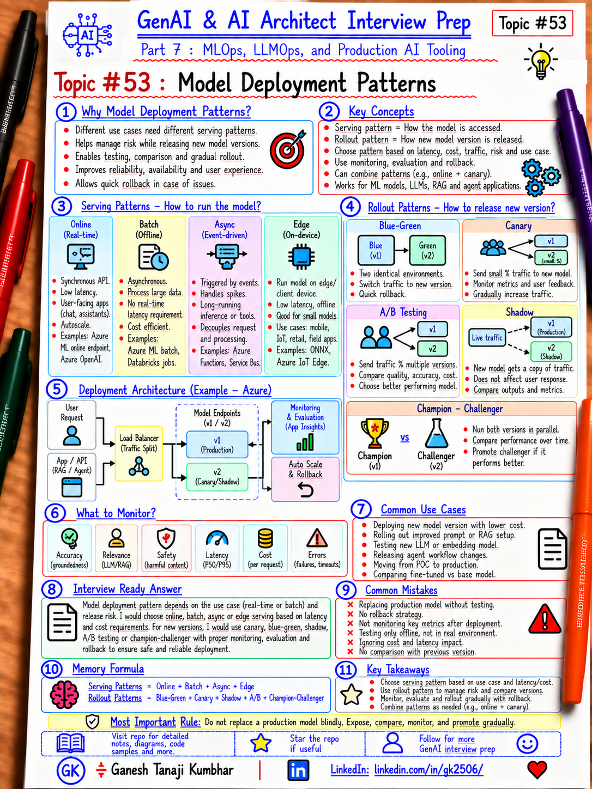

# GenAI & AI Architect Interview Prep

# Topic #53: Model Deployment Patterns



---

## Important Note: Continuing Part 7

In the previous topics, we covered:

- What MLOps is and why AI Architects should understand it
- The ML lifecycle
- Experiment tracking and model registry
- Data versioning, feature store, and dataset governance
- CI/CD for ML and GenAI applications

Now we move to the next practical production topic:
 
```text
Model Deployment Patterns
```

Training a good model is not enough.

You also need to decide:

```text
How should the model be exposed?
How should traffic reach it?
How should a new version be released?
How do we compare old vs new?
How do we roll back safely?
How do we limit blast radius?
```

Important learning point:

> Model deployment is not only "put model behind an API." It includes serving pattern, rollout strategy, traffic control, versioning, monitoring, rollback, and operational safety.

---

## Question

In an interview, you may be asked:

> What are common model deployment patterns?

Or:

> How would you deploy a new model safely?

Or:

> What is the difference between blue-green, canary, shadow, and A/B deployment?

Or:

> When would you use online vs batch inference?

Or:

> How do champion-challenger deployments work?

---

## Why Interviewer Asks This

A weak answer is:

```text
Train model
→ Deploy endpoint
→ Done
```

Production AI needs more thought.

The architect must consider:

- Real-time vs batch inference
- Traffic volume
- Latency
- Model size
- Cost
- GPU/CPU requirements
- Versioning
- Rollback
- Experimentation
- Risk
- Monitoring
- Business criticality

Important line:

> The deployment pattern should match both the inference workload and the risk of changing the model.

---

## Basic Answer

A simple way to classify model deployment is:

### Serving Pattern

```text
Online / Real-time
Batch
Asynchronous
Edge
Embedded
```

### Rollout Pattern

```text
Recreate
Rolling
Blue-Green
Canary
Shadow
A/B Testing
Champion-Challenger
```

Important distinction:

> Serving pattern answers "how predictions are delivered." Rollout pattern answers "how a new model version is introduced."

---

## Architect-Level Answer

A strong architect-level answer would be:

> I would first choose the serving pattern based on business latency and throughput requirements. For user-facing or transactional scoring, I would use an online endpoint. For large offline datasets, I would use batch inference. For long-running or bursty workloads, I may use asynchronous queue-based processing. For rollout, I would avoid switching 100% of traffic to a new model without validation. Depending on risk, I would use blue-green, canary, shadow, A/B testing, or champion-challenger. I would keep model versions immutable, monitor both system and model-quality metrics, define rollback criteria before release, and make the deployment traceable to the model, data, code, and evaluation that produced it.

---

## Must Mention in Interview

### 1. Online / Real-Time Inference

Online inference is used when the application needs a prediction immediately.

Example:

```text
User / Application
      ↓
REST / gRPC Endpoint
      ↓
Model
      ↓
Prediction
```

Typical use cases:

- Fraud detection
- Recommendation
- Risk scoring
- Classification
- Real-time personalization
- Interactive AI applications

Important considerations:

- Latency
- Throughput
- Autoscaling
- Availability
- Authentication
- Rate limiting
- Model warm-up
- Cost
- Observability

Important line:

> Use online serving when prediction latency is part of the user or transaction flow.

---

### 2. Batch Inference

Batch inference processes many records together.

Example:

```text
Data Lake / SQL
      ↓
Batch Job
      ↓
Model
      ↓
Predictions
      ↓
Storage / Report
```

Typical use cases:

- Nightly risk scoring
- Customer segmentation
- Forecasting
- Bulk document classification
- Monthly prediction jobs

Benefits:

- Cost efficient
- High throughput
- No strict real-time latency
- Easier resource scheduling

Tradeoff:

- Predictions are not immediate

Important line:

> If the business does not need real-time predictions, batch may be simpler and cheaper.

---

### 3. Asynchronous Inference

Some predictions take too long for a synchronous API request.

Pattern:

```text
Client
  ↓
Submit Job
  ↓
Queue
  ↓
Worker / Model
  ↓
Store Result
  ↓
Notify / Poll
```

Useful for:

- Large models
- Long documents
- Multi-step inference
- GPU-heavy work
- High-volume bursts

Important line:

> Async inference decouples request arrival from model processing capacity.

---

### 4. Edge Deployment

Sometimes the model must run close to the device.

Examples:

- Manufacturing
- IoT
- Mobile
- Retail devices
- Vehicles
- Offline environments

Benefits:

- Low latency
- Reduced network dependency
- Data may remain local

Challenges:

- Limited compute
- Model compression
- Version rollout
- Device management
- Security

Important line:

> Edge inference trades centralized operational simplicity for latency, autonomy, or privacy.

---

### 5. Recreate Deployment

Simplest rollout:

```text
Stop v1
Deploy v2
Start v2
```

Benefits:

- Simple
- Easy to understand

Risks:

- Downtime
- Full blast radius
- Slow rollback

Suitable for:

- Low-risk internal systems
- Non-critical batch workloads
- Development environments

Important line:

> Recreate is simple, but usually not ideal for critical real-time systems.

---

### 6. Rolling Deployment

Replace instances gradually.

```text
v1 v1 v1 v1
→
v2 v1 v1 v1
→
v2 v2 v1 v1
→
v2 v2 v2 v2
```

Benefits:

- No full outage
- Gradual replacement

Challenges:

- v1 and v2 may run together
- Compatibility must be maintained
- Rollback may be slower than blue-green

Important line:

> Rolling deployment reduces downtime but requires compatibility during mixed-version operation.

---

### 7. Blue-Green Deployment

Maintain two environments:

```text
Blue  = Current Production
Green = Candidate Version
```

Flow:

```text
Users
  ↓
Traffic Router
  ├── Blue v1
  └── Green v2
```

Validate Green, then switch traffic.

Benefits:

- Fast cutover
- Fast rollback
- Clear separation

Tradeoffs:

- Temporary duplicate infrastructure
- More cost

Important line:

> Blue-green is strong when fast rollback and isolation are important.

---

### 8. Canary Deployment

Send a small percentage of production traffic to the new model.

```text
95% → Model v1
5%  → Model v2
```

If healthy:

```text
90/10
75/25
50/50
0/100
```

Monitor:

- Error rate
- Latency
- Prediction distribution
- Quality
- Cost
- Business KPI
- User feedback

Important line:

> Canary deployment validates a candidate on limited real traffic before full promotion.

---

### 9. Shadow Deployment

The new model receives a copy of real production requests but its result is not returned to users.

```text
Request
  ↓
Production Model v1
  ↓
User gets v1 result

Same Request
  ↓
Shadow Model v2
  ↓
Result logged only
```

Benefits:

- Real traffic
- No user impact
- Compare outputs safely

Challenges:

- Double compute cost
- Data privacy
- Offline comparison required

Important line:

> Shadow deployment lets you observe candidate behavior under real traffic without changing user experience.

---

### 10. A/B Testing

A/B testing intentionally sends different users to different versions.

```text
50% Users → Model A
50% Users → Model B
```

Measure:

- Conversion
- Engagement
- Acceptance
- Revenue
- Business outcome

Important difference:

```text
Canary
→ mainly release safety

A/B Testing
→ mainly experimentation and business comparison
```

Important line:

> Canary asks "is it safe?" A/B testing asks "which version performs better?"

---

### 11. Champion-Challenger

```text
Champion
= current production model

Challenger
= candidate model
```

The challenger may run:

- Offline
- Shadow
- On a traffic subset

Compare:

- Accuracy
- Recall
- Precision
- Cost
- Latency
- Business KPIs

If challenger wins:

```text
Challenger → New Champion
```

Important line:

> Champion-challenger is a model governance pattern for continuously evaluating new candidates against the current production model.

---

### 12. Multi-Model Deployment

Some systems host multiple models simultaneously.

```text
Request
  ↓
Router
  ├── Model A → simple classification
  ├── Model B → high-risk prediction
  └── Model C → premium use case
```

Reasons:

- Different use cases
- Different tenants
- Different geographies
- Different capabilities
- Cost optimization

Important line:

> Multi-model serving should be intentional and observable, not uncontrolled model sprawl.

---

### 13. Model Versioning

Each deployment should identify:

```text
Model Name
Model Version
Training Run
Dataset Version
Code Version
Evaluation Results
Approval Status
Deployment Target
```

Example:

```text
ExpenseFraudModel:v12
```

Important line:

> Never deploy "latest" without a traceable immutable model version.

---

### 14. Rollback Strategy

Before deployment, define:

```text
What metric triggers rollback?
How quickly can we revert?
Which version is the known-good version?
Can old and new schemas coexist?
```

Example:

```text
P95 latency > 300ms
OR
Fraud recall drops > 3%
OR
Error rate > 2%
→ rollback
```

Important line:

> Rollback criteria should be defined before release, not during the incident.

---

### 15. Deployment Approval

Not every model should move automatically to production.

Approval may include:

- Technical review
- Model quality review
- Business review
- Security review
- Responsible AI review
- Compliance review

Important line:

> Automation should not remove required governance.

---

## Real-World Example: Expense Fraud Detection Model

Current production:

```text
ExpenseFraudModel v11
```

New candidate:

```text
ExpenseFraudModel v12
```

Offline evaluation:

```text
Recall:
v11 = 89%
v12 = 93%

False Positive Rate:
v11 = 4%
v12 = 6%
```

Should v12 immediately replace v11?

Not necessarily.

You may use:

```text
Shadow
→ Compare on real production traffic

Canary
→ 5% production traffic

Champion-Challenger
→ Compare business outcomes
```

Then decide whether to promote.

---

## Example Safe Rollout

```text
Register Model v12
      ↓
Deploy to Test
      ↓
Evaluation Gate
      ↓
Shadow Production
      ↓
Canary 5%
      ↓
Canary 25%
      ↓
Full Production
```

At every stage:

```text
Monitor
→ Compare
→ Continue or Rollback
```

---

## GenAI Model Deployment Example

This also applies to GenAI systems.

Suppose you change:

```text
LLM deployment
Prompt version
Model routing policy
Embedding model
```

A rollout could use:

```text
5% → New configuration
95% → Current configuration
```

Measure:

- Groundedness
- Hallucination
- Tool-call accuracy
- Latency
- Token cost
- Safety
- User feedback

Important line:

> GenAI configuration changes should be rolled out with the same discipline as model changes.

---

## Microsoft-Stack View

For Microsoft / Azure teams:

```text
Model Registry
    ↓
Azure Machine Learning
    ↓
Managed Online Endpoint / Batch Endpoint
    ↓
Traffic Split
    ├── Deployment v1
    └── Deployment v2
```

Or:

```text
Containerized Model
    ↓
Azure Container Apps / AKS
    ↓
Traffic Management
    ↓
Model Versions
```

Possible supporting services:

- Azure Machine Learning
- MLflow
- Azure Container Registry
- Azure Kubernetes Service
- Azure Container Apps
- Azure Monitor
- Application Insights
- Azure DevOps
- GitHub Actions
- Microsoft Entra ID
- Azure Key Vault

Important line:

> The Azure service can vary; the rollout principles remain the same.

---

## What Should Be Monitored During Deployment?

### System Metrics

```text
Latency
Throughput
CPU
GPU
Memory
Errors
Availability
Timeouts
```

### Model Metrics

```text
Prediction distribution
Confidence
Accuracy
Precision
Recall
Drift
False positives
False negatives
```

### Business Metrics

```text
Conversion
Approval rate
Fraud caught
Customer complaints
Revenue impact
```

### GenAI Metrics

```text
Groundedness
Hallucination
Tool-call accuracy
Safety
Token usage
Cost
User feedback
```

Important line:

> Deployment health requires technical, model, and business signals.

---

## Common Mistakes

### Mistake 1: 100% Traffic Immediately

Bad:

```text
v1 → v2 for everyone
```

Better:

```text
Shadow / Canary / Blue-Green
```

### Mistake 2: No Rollback

Always retain a known-good version.

### Mistake 3: "Latest" Model in Production

Bad:

```text
model/latest
```

Better:

```text
ExpenseFraudModel:v12
```

### Mistake 4: Only Monitor HTTP Errors

HTTP 200 does not mean model quality is good.

### Mistake 5: A/B and Canary Treated as the Same

```text
Canary = release risk
A/B = business experiment
```

### Mistake 6: Ignore Cost During Shadow Deployment

Shadow traffic may increase inference cost significantly.

### Mistake 7: No Data Compatibility Check

New model may expect a different feature schema.

### Mistake 8: No Approval for High-Risk Models

High-risk decisions may require human governance.

---

## What Can Go Wrong?

### 1. Model Quality Regression

Fix:

```text
Shadow + Canary + Monitor
```

### 2. Latency Regression

Fix:

```text
Latency gate + traffic split + rollback
```

### 3. Feature Schema Mismatch

Fix:

```text
Schema validation + versioned feature contracts
```

### 4. Cost Explosion

Fix:

```text
Cost monitoring + canary + budget thresholds
```

### 5. Bias or Segment Regression

Fix:

```text
Segment-level evaluation + responsible AI checks
```

### 6. Inference Infrastructure Failure

Fix:

```text
Load testing + autoscaling + resilience + rollback
```

---

## Better Interview Answer

> I separate serving patterns from rollout patterns. For serving, I choose online, batch, asynchronous, or edge inference based on business latency, throughput, and cost requirements. For releasing a new model version, I avoid sending 100% traffic immediately unless risk is very low. Depending on the use case, I may use blue-green for fast rollback, canary for gradual production exposure, shadow deployment for no-impact comparison, A/B testing for business experimentation, or champion-challenger for model governance. I keep model versions immutable and traceable, define rollback thresholds before release, compare technical, model-quality, and business metrics, and promote only when the candidate proves better and safe in production.

---

## One-Line Answer

> Choose the serving pattern based on latency and workload, and choose the rollout pattern based on release risk, validation needs, and rollback requirements.

---

## Memory Formula

```text
Serving
= Online + Batch + Async + Edge

Rollout
= Blue-Green + Canary + Shadow + A/B + Champion-Challenger
```

Short interview memory:

```text
Canary
= Is it SAFE?

A/B
= Is it BETTER?

Shadow
= How does it BEHAVE?

Blue-Green
= Can I SWITCH and ROLLBACK quickly?

Champion-Challenger
= Should the CANDIDATE replace production?
```

Most important rule:

```text
Do not replace a production model blindly.
Expose, compare, monitor, and promote gradually.
```

---

## Interview Closing Line

> I treat model deployment as a controlled production change, not simply an endpoint update. I choose the serving pattern based on workload needs and the rollout strategy based on risk, then use versioning, traffic control, monitoring, evaluation, and rollback to make the release safe.

---

## Related Upcoming Topics

- Model Monitoring, Drift, Feedback, and Retraining
- LLMOps for Prompts, RAG, Agents, and Evaluation
- AI Evaluation and Quality Gates for RAG and Agents
- Actual MLOps and LLMOps Tools Used in Practice
- MLOps vs LLMOps vs DevOps
- Responsible AI, Governance, and Release Controls

---

## Reference Scenario

This topic uses the **Expense Fraud Detection Model** to explain:

- Online inference
- Versioned deployment
- Shadow testing
- Canary rollout
- Champion-challenger
- Rollback

The broader Expense Management AI Agent scenario remains available here:

```text
00-common-examples/expense-management-ai-agent-scenario.md
```

---

## About the Author

These notes are created and maintained by **Ganesh Tanaji Kumbhar**, an **AI Architect** with experience in **.NET, Azure, cloud architecture, infrastructure, enterprise application modernization, and GenAI solution design**.

I bring practical experience across:

- **.NET / C# / ASP.NET / Web API**
- **Azure App Services, Azure Functions, WebJobs, Azure SQL, Storage, Redis**
- **Cloud architecture and infrastructure modernization**
- **Application architecture and enterprise system design**
- **CI/CD, DevOps, monitoring, and production support**
- **GenAI, RAG, Agentic AI, and AI architecture patterns**

These notes are based on my real experience as both:

- An **interviewee**, facing AI, architecture, cloud, .NET, Azure, and system design rounds
- An **interviewer**, evaluating how candidates explain concepts, tradeoffs, project experience, and real-world design decisions

I write about:

- GenAI Architecture
- RAG System Design
- Agentic AI
- AI Architect Interview Preparation
- .NET and Azure Architecture
- Cloud and Enterprise AI Patterns

If you are preparing for **GenAI / AI Architect / Staff Engineer / Solution Architect / .NET Architect / Azure Architect** interviews, feel free to connect with me on LinkedIn.

🔗 **LinkedIn:** [Connect with me on LinkedIn](https://www.linkedin.com/in/gk2506/)

💬 You can also DM me on LinkedIn if you want to discuss AI architecture, interview preparation, .NET/Azure architecture, or practical GenAI learning.
