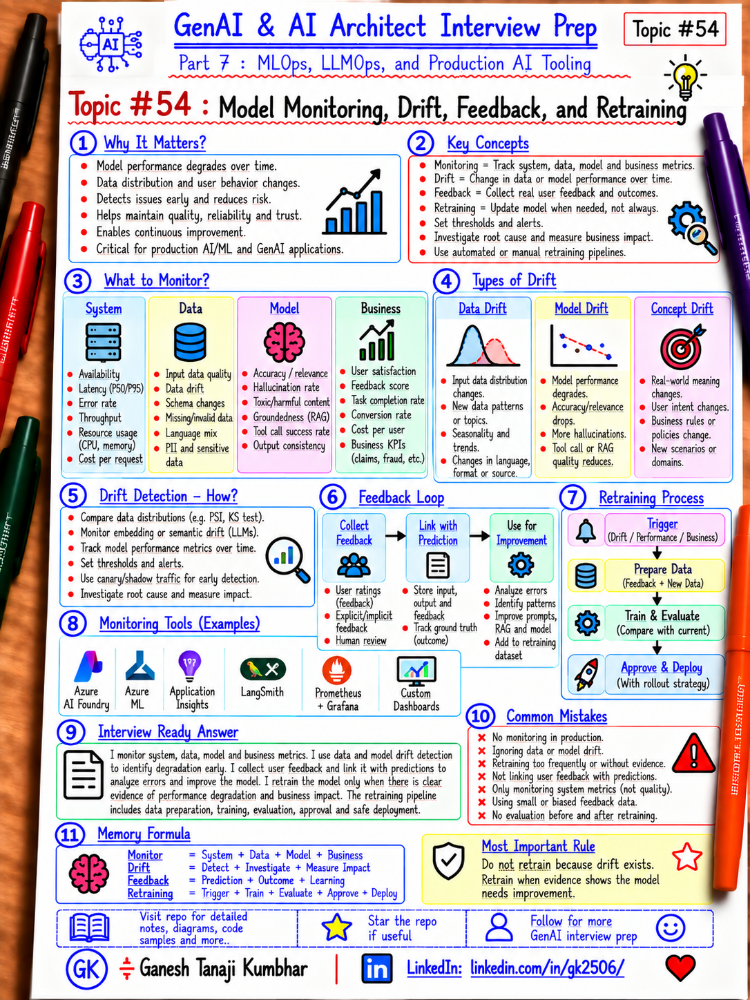

# GenAI & AI Architect Interview Prep

# Topic #54: Model Monitoring, Drift, Feedback, and Retraining



---

## Important Note: Continuing Part 7

In the previous topics, we covered:

- What MLOps is and why AI Architects should understand it
- ML lifecycle
- Experiment tracking and model registry
- Data versioning, feature store, and dataset governance
- CI/CD for ML and GenAI applications
- Model deployment patterns

Now we move to one of the most important production MLOps topics:

```text
Model Monitoring, Drift, Feedback, and Retraining
```

A model can be technically healthy and still become bad for the business.

Example:

```text
HTTP 200
Latency normal
CPU normal
No deployment failure

BUT

Prediction quality is getting worse
Input data changed
User behavior changed
Business rules changed
```

Important learning point:

> Production model monitoring must cover infrastructure, model behavior, data changes, business outcomes, and feedback — not only application health.

---

## Question

In an interview, you may be asked:

> How do you monitor a machine learning model in production?

Or:

> What is data drift vs model drift?

Or:

> When should a model be retrained?

Or:

> How do you collect feedback for a production model?

Or:

> How do you detect silent model degradation?

---

## Why Interviewer Asks This

A weak answer is:

```text
We monitor CPU, memory, latency, and errors.
```

That is only application monitoring.

A production model can return successful responses while prediction quality degrades.

A strong AI Architect should understand:

- Operational monitoring
- Data drift
- Feature drift
- Prediction drift
- Model quality degradation
- Business KPI monitoring
- Feedback loops
- Label delay
- Retraining triggers
- Evaluation before promotion
- Rollback
- Governance

Important line:

> A healthy endpoint does not automatically mean a healthy model.

---

## Basic Answer

> I would monitor both system health and model quality. System metrics include latency, errors, throughput, CPU, memory, availability, and cost. ML-specific monitoring includes input-data drift, feature drift, prediction distribution, model quality, confidence, segment-level performance, and business outcomes. I would collect feedback where possible, define retraining triggers, and send every retrained model through evaluation, approval, registration, and controlled deployment before production.

Simple flow:

```text
Production Model
      ↓
Predictions
      ↓
Monitoring
      ↓
Drift / Quality Signals
      ↓
Feedback
      ↓
Retraining Decision
      ↓
Train Candidate
      ↓
Evaluate
      ↓
Approve
      ↓
Deploy
```

---

## Architect-Level Answer

> I separate operational monitoring from model-quality monitoring. Operational metrics tell me whether the endpoint is available and performing technically, while ML-specific metrics tell me whether the model is still behaving correctly. I monitor input distributions, feature distributions, prediction distributions, quality metrics where labels are available, confidence, segment-level performance, and business KPIs. Because labels are often delayed, I may use proxy signals until ground truth arrives. Drift should trigger investigation, not automatic production deployment. If retraining is needed, the new candidate still goes through evaluation, approval, model registration, controlled rollout, and rollback planning.

---

## Must Mention in Interview

### 1. Monitor the System and the Model Separately

### System / Operational Monitoring

Track:

```text
Latency
Throughput
Availability
Error rate
Timeouts
CPU
Memory
GPU
Queue depth
Autoscaling
Cost
```

This answers:

```text
Is the service technically healthy?
```

### ML / Model Monitoring

Track:

```text
Prediction quality
Data drift
Feature drift
Prediction distribution
Confidence
False positives
False negatives
Segment performance
Business KPI
```

This answers:

```text
Is the model still useful and correct?
```

Important line:

> Infrastructure monitoring tells you whether the model is running. Model monitoring tells you whether it is still good.

---

### 2. What Is Data Drift?

Data drift means the production input distribution changes compared with the training data.

Example:

```text
Training:
Average hotel expense = ₹4,500

Production:
Average hotel expense = ₹8,000
```

Possible reasons:

- Inflation
- New customer segment
- Seasonal behavior
- New geography
- New policy
- Business process change

Important line:

> Data drift means the world changed, even though the model did not.

---

### 3. Feature Drift

Feature drift means a model input feature changes significantly over time.

Example:

```text
Training:
MissingReceipt = 10%

Production:
MissingReceipt = 45%
```

Possible causes:

- Upstream integration changed
- User behavior changed
- Feature calculation changed
- New data source added

Important line:

> Feature drift may represent a genuine business change or a data-pipeline problem.

---

### 4. Prediction Drift

Prediction drift means the output distribution changes.

Example:

```text
Earlier:
High-risk expenses = 5%

Current:
High-risk expenses = 28%
```

Possible causes:

- Real behavior changed
- Input drift
- Model degraded
- Feature bug
- Threshold changed

Important line:

> Prediction drift is a warning signal, not proof that the model is wrong.

---

### 5. Model Performance Drift

Model quality can degrade over time.

Example:

```text
Fraud Recall at deployment = 92%
Fraud Recall after 6 months = 78%
```

Possible reasons:

- Fraud patterns changed
- Market changed
- Customer behavior changed
- Labels changed
- Upstream data changed

Important line:

> A model that was good at deployment may become poor later.

---

### 6. Data Drift vs Concept Drift

A useful interview distinction:

```text
Data Drift
= P(X) changes

Concept Drift
= P(Y|X) changes
```

Data drift means input distribution changed.

Concept drift means the relationship between input and outcome changed.

Important line:

> Data drift means the inputs changed. Concept drift means what those inputs mean for the outcome changed.

---

### 7. Drift Does Not Automatically Mean Retrain

Bad:

```text
Drift detected
→ Retrain
→ Deploy
```

Better:

```text
Drift detected
→ Investigate
→ Confirm business impact
→ Retrain if needed
→ Evaluate
→ Approve
→ Deploy safely
```

Important line:

> Drift is a signal to investigate, not an automatic deployment trigger.

---

### 8. Feedback Loop

Feedback helps determine whether predictions were correct.

Examples:

```text
Was fraud prediction confirmed?
Did a reviewer override the model?
Did the user accept the recommendation?
Was the claim later approved or rejected?
```

Feedback can come from:

- Human review
- User action
- Business outcome
- Delayed labels
- Downstream system
- Explicit rating

Simple flow:

```text
Prediction
   ↓
Real-world outcome
   ↓
Feedback
   ↓
Evaluation
   ↓
Retraining Dataset
```

Important line:

> Without feedback, production model quality is difficult to measure.

---

### 9. Labels May Arrive Late

Many outcomes are not known immediately.

Example:

```text
Fraud prediction today
↓
Investigation completes after 30 days
↓
True label becomes available
```

Until labels arrive, monitor proxy signals such as:

- Prediction distribution
- Confidence
- Input drift
- Human overrides
- Business exceptions

Important line:

> Real-world model monitoring often works with delayed ground truth.

---

### 10. Monitor by Segment

Overall performance can hide failures.

Example:

```text
Overall Accuracy = 94%

Region A = 97%
Region B = 81%
```

Monitor relevant segments such as:

- Geography
- Product
- Customer type
- Tenant
- Risk group
- Device type

Important line:

> Average performance can hide serious subgroup regressions.

---

### 11. Business Metrics Matter

For a fraud model:

Technical metric:

```text
Recall
```

Business metrics:

```text
Fraud prevented
False-positive investigation cost
Customer complaints
Approval delay
Manual-review workload
```

Important line:

> The best model metric is not useful if the business outcome gets worse.

---

### 12. Confidence Monitoring

Some models produce confidence or probability scores.

Example:

```text
Fraud probability = 0.87
```

Monitor:

- Confidence distribution
- Sudden changes
- Low-confidence percentage
- Calibration

Important line:

> Model confidence is not the same as correctness.

---

### 13. Define Alert Thresholds

Monitoring should lead to action.

Examples:

```text
P95 latency > 500ms
→ alert

Drift score > threshold
→ investigate

Recall drops > 5%
→ investigate / block promotion

Business KPI drops
→ escalate
```

Important line:

> A metric without an action threshold is only a dashboard.

---

### 14. Retraining Triggers

Retraining can be triggered by:

```text
Schedule
Enough new labeled data
Drift
Quality degradation
Business rule change
New market / product
```

Important line:

> Retraining should be driven by evidence, not habit alone.

---

### 15. Retraining Is Not Automatic Promotion

Correct flow:

```text
Trigger
  ↓
Retrain
  ↓
Evaluate
  ↓
Compare with Champion
  ↓
Approval
  ↓
Register
  ↓
Controlled Deployment
```

Important line:

> Retraining creates a candidate model, not automatically a production model.

---

### 16. Champion-Challenger After Retraining

Current:

```text
Champion v12
```

Retrained:

```text
Challenger v13
```

Compare:

- Accuracy
- Recall
- Precision
- Latency
- Cost
- Segment performance
- Business KPI

If challenger wins:

```text
v13 → New Champion
```

Important line:

> Retrained models should prove they are better before replacing production.

---

### 17. Rollback Still Matters

Always keep:

- Previous known-good model
- Deployment history
- Rollback path
- Monitoring thresholds

Important line:

> Retraining does not remove release risk.

---

## Real-World Example: Expense Fraud Detection

Current production:

```text
ExpenseFraudModel v12
```

At deployment:

```text
Recall = 92%
False Positive Rate = 4%
```

Six months later:

```text
Recall = 80%
False Positive Rate = 8%
```

Monitoring also shows:

```text
Average transaction amount increased
Merchant distribution changed
Missing receipts increased
```

Possible interpretation:

```text
Data drift
+
Possible model-performance degradation
```

Do not immediately retrain.

Investigate:

```text
Did business behavior change?
Did upstream data change?
Did fraud patterns change?
Did feature logic change?
```

Then:

```text
Prepare new labeled dataset
→ Retrain
→ Evaluate
→ Compare
→ Register
→ Canary
→ Promote or Rollback
```

---

## Feedback Example

The fraud team reviews flagged expenses.

Capture:

```text
ExpenseId
PredictedRisk
HumanDecision
ConfirmedFraud
Reason
Timestamp
```

Later:

```text
Feedback
→ Evaluation Dataset
→ Retraining Dataset
```

Important line:

> Human decisions can become one of the most valuable production learning signals.

---

## Microsoft-Stack View

For Microsoft / Azure teams, a possible architecture is:

```text
Production App
      ↓
Azure ML Endpoint / Containerized Model
      ↓
Prediction Logs
      ↓
Monitoring / Data Collection
      ↓
Azure Monitor / Application Insights / ML Monitoring
      ↓
Drift / Quality Analysis
      ↓
Retraining Pipeline
      ↓
Model Registry
      ↓
Controlled Deployment
```

Possible services:

- Azure Machine Learning
- MLflow
- Azure Monitor
- Application Insights
- Log Analytics
- Azure Data Lake / Blob Storage
- Microsoft Fabric
- Azure DevOps / GitHub Actions
- Azure Container Registry
- Microsoft Entra ID
- Azure Key Vault

Important line:

> The architecture should connect prediction telemetry, ground truth, evaluation, retraining, registry, and deployment.

---

## What Should Be Logged?

Consider tracking:

```text
modelName
modelVersion
deploymentId
predictionId
timestamp
prediction
confidence
latency
error
segment
businessContext
feedbackStatus
actualOutcome
driftScore
qualityMetric
retrainingTrigger
```

Avoid unnecessarily logging:

- Raw PII
- Sensitive features
- Secrets
- Full payloads without governance

Important line:

> Monitoring data itself must follow security and privacy rules.

---

## Common Mistakes

### Mistake 1: Only Monitor Infrastructure

Bad:

```text
CPU normal
HTTP 200
Therefore model healthy
```

Better:

```text
Quality
+ Drift
+ Feedback
+ Business KPI
```

### Mistake 2: Treat Every Drift Alert as Failure

Drift is not always harmful.

Investigate before acting.

### Mistake 3: Automatically Retrain and Deploy

Retraining still needs:

```text
Evaluation
Approval
Registration
Controlled rollout
```

### Mistake 4: No Ground Truth

Without labels or feedback, quality monitoring becomes weak.

### Mistake 5: Only Monitor Global Average

Segment-level failures may be hidden.

### Mistake 6: Ignore Business Metrics

Model metric improves but business outcome worsens.

That is not success.

### Mistake 7: No Ownership

Someone must own:

- Monitoring
- Alert response
- Retraining decision
- Model approval
- Rollback

Important line:

> A monitoring system without an owner is just a dashboard.

---

## What Can Go Wrong?

### 1. Silent Quality Degradation

Fix:

```text
Model-quality monitoring + feedback
```

### 2. False Drift Alerts

Fix:

```text
Context-aware thresholds + baseline windows
```

### 3. Missing Labels

Fix:

```text
Proxy signals + delayed evaluation pipeline
```

### 4. Retraining on Bad Data

Fix:

```text
Data quality gates + versioning + governance
```

### 5. Model Improves Overall but Hurts One Segment

Fix:

```text
Segment-level evaluation
```

### 6. Feedback Loop Introduces Bias

Fix:

```text
Feedback quality review + governance + sampling
```

---

## Better Interview Answer

> I would monitor a production model at three levels: system health, model behavior, and business outcome. System metrics tell me whether the endpoint is reliable, while model metrics tell me whether data distributions, prediction distributions, confidence, and quality are changing. Where labels are available, I would track metrics such as precision, recall, or error over time; where labels are delayed, I would use drift and proxy signals until ground truth arrives. I would also monitor important user or business segments separately. Drift would trigger investigation, not automatic deployment. If retraining is needed, I would create a new candidate model, evaluate it against the current champion, register and approve it, then deploy it through a controlled rollout with rollback capability.

---

## One-Line Answer

> Model monitoring combines system health, drift, prediction quality, feedback, and business metrics, while retraining should create an evaluated candidate rather than automatically replacing production.

---

## Memory Formula

```text
Monitor
= System + Data + Model + Business

Drift
= Detect + Investigate + Measure Impact

Feedback
= Prediction + Outcome + Learning

Retraining
= Trigger + Train + Evaluate + Approve + Deploy
```

Short interview memory:

```text
Observe
→ Detect
→ Investigate
→ Learn
→ Retrain
→ Evaluate
→ Release
```

Most important rule:

```text
Do not retrain because drift exists.
Retrain when evidence shows the model needs improvement.
```

---

## Interview Closing Line

> I treat monitoring as part of the model lifecycle, not as an afterthought. The goal is to detect when the world, data, or model behavior changes, connect that signal to real business impact, and improve the model through a controlled and traceable retraining process.

---

## Related Upcoming Topics

- LLMOps for Prompts, RAG, Agents, and Evaluation
- AI Evaluation and Quality Gates for RAG and Agents
- Actual MLOps and LLMOps Tools Used in Practice
- MLOps vs LLMOps vs DevOps
- Responsible AI, Governance, and Release Controls

---

## Reference Scenario

This topic uses the **Expense Fraud Detection Model** to explain:

- Model monitoring
- Data drift
- Model performance degradation
- Human feedback
- Retraining
- Champion-challenger
- Controlled deployment

The broader Expense Management AI Agent scenario remains available here:

```text
00-common-examples/expense-management-ai-agent-scenario.md
```

---

## About the Author

These notes are created and maintained by **Ganesh Tanaji Kumbhar**, an **AI Architect** with experience in **.NET, Azure, cloud architecture, infrastructure, enterprise application modernization, and GenAI solution design**.

I bring practical experience across:

- **.NET / C# / ASP.NET / Web API**
- **Azure App Services, Azure Functions, WebJobs, Azure SQL, Storage, Redis**
- **Cloud architecture and infrastructure modernization**
- **Application architecture and enterprise system design**
- **CI/CD, DevOps, monitoring, and production support**
- **GenAI, RAG, Agentic AI, and AI architecture patterns**

These notes are based on my real experience as both:

- An **interviewee**, facing AI, architecture, cloud, .NET, Azure, and system design rounds
- An **interviewer**, evaluating how candidates explain concepts, tradeoffs, project experience, and real-world design decisions

I write about:

- GenAI Architecture
- RAG System Design
- Agentic AI
- AI Architect Interview Preparation
- .NET and Azure Architecture
- Cloud and Enterprise AI Patterns

If you are preparing for **GenAI / AI Architect / Staff Engineer / Solution Architect / .NET Architect / Azure Architect** interviews, feel free to connect with me on LinkedIn.

🔗 **LinkedIn:** [Connect with me on LinkedIn](https://www.linkedin.com/in/gk2506/)

💬 You can also DM me on LinkedIn if you want to discuss AI architecture, interview preparation, .NET/Azure architecture, or practical GenAI learning.
