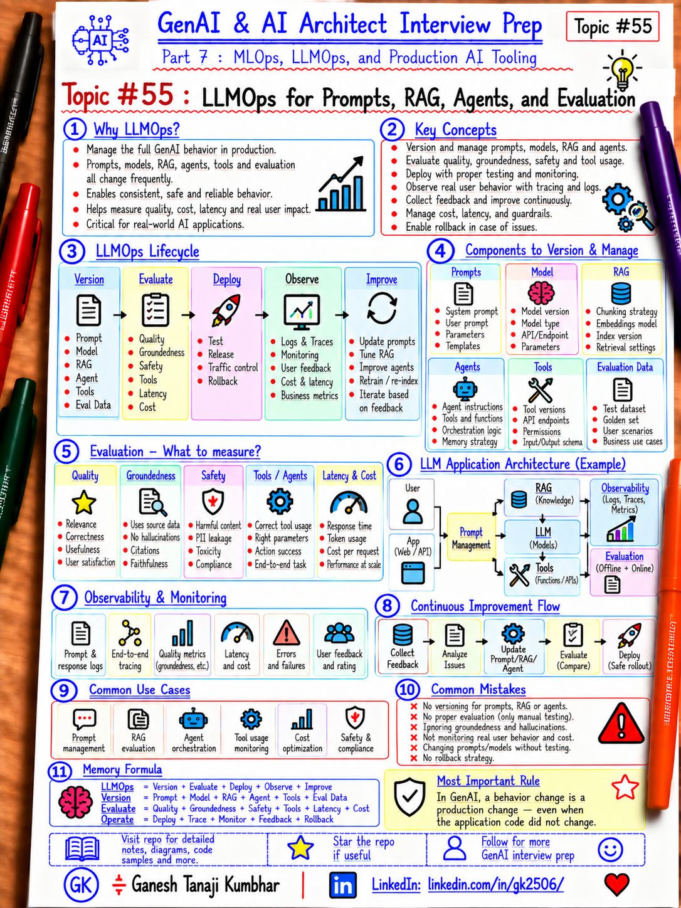

# GenAI & AI Architect Interview Prep

# Topic #55: LLMOps for Prompts, RAG, Agents, and Evaluation



---

## Important Note: Continuing Part 7

So far in Part 7 we covered the ML lifecycle, experiment tracking, data/version governance, CI/CD, model deployment, monitoring, drift, feedback, and retraining.

Now we move into the operational layer specific to GenAI systems:

```text
LLMOps for Prompts, RAG, Agents, and Evaluation
```

A GenAI application can change behavior even when the application code and infrastructure do not change.

Why?

Because someone may change:

```text
Prompt
Model configuration
Chunking
Embedding model
Top-K
Reranker
Knowledge base
Agent instruction
Tool schema
Safety policy
```

> LLMOps manages the lifecycle of the complete GenAI behavior, not only the underlying model.

---

## Question

In an interview, you may be asked:

> What is LLMOps?

> How is LLMOps different from MLOps?

> How do you version and release prompts?

> How do you manage RAG changes safely?

> How do you test AI agents and tools before production?

> What should be evaluated before a GenAI release?

---

## Why Interviewer Asks This

A weak answer is:

```text
LLMOps is MLOps for LLMs.
```

That is too shallow.

A production GenAI system may contain:

```text
Application Code
+ Prompt
+ Model Configuration
+ RAG Pipeline
+ Knowledge Base
+ Embedding Model
+ Agent Instructions
+ Tools
+ Evaluation Dataset
+ Safety Rules
+ Infrastructure
```

An AI Architect should know how these are versioned, evaluated, released, monitored, compared, rolled back, and audited.

> In GenAI, behavior is distributed across prompts, retrieval, models, tools, and orchestration.

---

## Basic Answer

> LLMOps is the production lifecycle for GenAI applications. It extends DevOps and MLOps with prompt versioning, RAG lifecycle management, model configuration, agent and tool testing, evaluation datasets, safety checks, observability, cost monitoring, controlled rollout, feedback, and rollback.

Simple lifecycle:

```text
Design
→ Version
→ Evaluate
→ Approve
→ Deploy
→ Observe
→ Collect Feedback
→ Improve
```

---

## Architect-Level Answer

> I treat LLMOps as lifecycle management for the full GenAI behavior. I version prompts, model configuration, RAG settings, indexes, embedding models, agent instructions, tool schemas, and evaluation datasets. Every candidate release is evaluated for quality, groundedness, safety, tool-call correctness, latency, and cost. I compare the candidate with the current baseline, apply quality gates, deploy through controlled environments, trace retrieval/generation/tool activity, and maintain rollback paths for both code and AI configuration.

---

## Must Mention in Interview

### 1. Prompts Are Production Assets

Track:

```text
Prompt Name
Prompt Version
System Prompt
Prompt Template
Few-shot Examples
Model Parameters
Owner
Approval Status
Evaluation Result
Release Version
```

Example:

```text
ExpensePolicyAssistant.SystemPrompt:v17
```

> A prompt change is a production behavior change.

---

### 2. Prompt Changes Need Evaluation

Bad:

```text
Edit Prompt → Deploy
```

Better:

```text
Edit
→ Version
→ Evaluate
→ Compare with Baseline
→ Review
→ Deploy
```

Evaluate:

- Correctness
- Relevance
- Groundedness
- Hallucination
- Safety
- Tone
- Latency
- Cost

> Prompt engineering without evaluation becomes trial-and-error in production.

---

### 3. Version Model Configuration

The same prompt can behave differently with:

```text
Different model
Temperature
Top-P
Max tokens
Tool choice
Response schema
Reasoning settings
```

> Model configuration is part of the release, not an environment detail to change casually.

---

### 4. RAG Has Its Own Lifecycle

RAG behavior can change because of:

```text
New documents
Chunking strategy
Embedding model
Index version
Metadata filters
Top-K
Hybrid search
Reranker
Generation prompt
```

Version the important parts.

> RAG quality is a pipeline problem, not only an LLM problem.

---

### 5. Evaluate Retrieval Separately from Generation

If the answer is wrong, determine whether:

```text
Retrieval failed to find the right content
OR
Generation misused the right content
```

Retrieval metrics may include:

```text
Recall@K
Precision@K
MRR
NDCG
Hit Rate
```

Generation metrics may include:

```text
Correctness
Groundedness
Relevance
Completeness
Hallucination
```

> Separate retrieval and generation evaluation makes root-cause analysis much easier.

---

### 6. Version Evaluation Datasets

Example:

```text
ExpensePolicyEvalSet:v5
```

Track:

- Question
- Expected answer
- Expected source
- Category
- Difficulty
- Business scenario
- Safety case
- Expected tool
- Human-reviewed label

> If the evaluation set changes without versioning, historical quality scores are hard to compare.

---

### 7. Compare Candidate vs Baseline

Example:

```text
Groundedness:
Current = 91%
Candidate = 94%

P95 Latency:
Current = 2.1 sec
Candidate = 3.8 sec

Cost / Request:
Current = ₹0.80
Candidate = ₹1.55
```

The candidate is not automatically better.

> GenAI releases involve tradeoffs across quality, safety, latency, and cost.

---

### 8. Agent Lifecycle

Agents add operational risk because they can:

- Choose tools
- Call APIs
- Modify data
- Retry
- Delegate
- Loop

Version:

```text
Agent Instruction
Tool List
Tool Schema
Routing Logic
Approval Rules
Max Steps
Timeout
Fallback
```

> Agent behavior should be treated as a governed workflow, not an unrestricted LLM loop.

---

### 9. Tool Testing

For every tool, test:

```text
Correct tool selected?
Correct parameters?
Unauthorized tool blocked?
Invalid input handled?
Timeout handled?
Retry safe?
Sensitive action requires approval?
```

> Tool correctness and tool authorization are both part of agent evaluation.

---

### 10. Human-in-the-Loop

Example:

```text
Read policy → Automatic
Recommend action → Automatic
Approve high-value payment → Human approval
```

LLMOps should capture approval rules, escalation, identity, and audit trail.

> Higher-risk actions need stronger controls than conversational responses.

---

### 11. GenAI Evaluation Categories

#### Quality

```text
Correctness
Relevance
Completeness
Groundedness
```

#### Safety

```text
Harmful content
PII leakage
Prompt injection
Policy violation
```

#### Agent

```text
Tool selection
Parameter correctness
Task completion
Loop prevention
Approval compliance
```

#### Operational

```text
Latency
Availability
Cost
Token usage
Errors
```

> A single accuracy score is not enough for GenAI.

---

### 12. Automated + Human Evaluation

Good pattern:

```text
Automated Evaluation
+
Human Review
```

Automated evaluation gives repeatability and scale.

Human evaluation helps with nuance, tone, business judgment, and high-risk edge cases.

---

### 13. LLM-as-a-Judge

An LLM can evaluate another LLM response for questions such as:

```text
Is the answer grounded?
Is it relevant?
Did the agent complete the task?
```

Benefits:

- Fast
- Scalable
- Useful for regression tests

Risks:

- Judge bias
- Prompt sensitivity
- Model dependence
- Inconsistent scoring

> LLM-as-a-Judge is useful, but it should itself be calibrated and validated.

---

### 14. Quality Gates

Example gates:

```text
Groundedness >= 90%
Tool-call accuracy >= 98%
0 critical safety regressions
P95 latency <= 3 sec
Cost/request <= budget
No critical security findings
```

If a gate fails:

```text
Do not promote
```

> A green software build is not enough; AI behavior must also pass release gates.

---

### 15. Observability and Tracing

Trace:

```text
User Request
→ Prompt
→ Retrieval
→ Documents
→ LLM
→ Tool Call
→ Tool Result
→ Final Response
```

Useful fields:

```text
traceId
requestId
promptVersion
modelVersion
indexVersion
retrievedDocumentIds
toolCalls
latency
tokenUsage
cost
evaluationSignals
```

> Without traces, debugging GenAI behavior becomes guesswork.

---

### 16. Prompt Injection and Runtime Security

Monitor for:

- Prompt injection
- Jailbreak attempts
- Malicious retrieved content
- Data exfiltration
- Unauthorized retrieval
- Unsafe tool calls

> Security testing must cover prompts, retrieved content, and tools — not only APIs.

---

### 17. Cost Monitoring

GenAI cost can change because of:

```text
Longer prompts
More retrieved chunks
More expensive model
More agent steps
Repeated tool calls
Higher output tokens
```

Track:

```text
Input tokens
Output tokens
Cost/request
Cost/user
Cost/tenant
Cost/workflow
```

> Cost is a production quality attribute in GenAI systems.

---

### 18. Rollback Must Include AI Configuration

Traditional rollback:

```text
Application v2 → v1
```

GenAI rollback may also require:

```text
Prompt v18 → v17
Index v9 → v8
Model config v6 → v5
Tool schema v5 → v4
Agent instruction v13 → v12
```

> Code rollback alone may not restore the previous AI behavior.

---

## Real-World Example: Expense Management AI Assistant

Production uses:

```text
App Version = 3.4
Prompt Version = 17
Policy Index = 8
Embedding Model = v3
Agent Instruction = 12
Tool Schema = 4
Evaluation Dataset = 6
```

Candidate release changes:

```text
Prompt v18
Top-K 5 → 8
New reranker
Tool Schema v5
```

Do not deploy based only on a few manual tests.

Run:

```text
Retrieval Evaluation
→ Generation Evaluation
→ Tool Evaluation
→ Safety Evaluation
→ Latency / Cost Evaluation
→ Baseline Comparison
→ Approval
→ Controlled Rollout
```

---

## Example Tradeoff

Suppose:

```text
Groundedness:
91% → 95%

P95 Latency:
2.2 sec → 4.9 sec

Cost / Request:
₹0.90 → ₹2.10
```

The release is not automatically successful.

The team must decide whether the quality gain justifies the latency and cost impact.

> LLMOps makes these tradeoffs measurable and controlled.

---

## LLMOps Release Flow

```text
Change
  ↓
Version
  ↓
Automated Tests
  ↓
Prompt / RAG / Agent Evaluation
  ↓
Security / Safety Checks
  ↓
Baseline Comparison
  ↓
Approval
  ↓
Deploy to Test
  ↓
Canary / Controlled Production Rollout
  ↓
Observe
  ↓
Feedback
```

---

## Microsoft-Stack View

A possible Microsoft / Azure flow:

```text
GitHub / Azure Repos
      ↓
Azure DevOps / GitHub Actions
      ↓
Code + Prompt + Evaluation Assets
      ↓
Azure AI Foundry / Azure OpenAI
      ↓
Azure AI Search
      ↓
Agent / Application Runtime
      ↓
Application Insights / Azure Monitor
      ↓
Evaluation + Feedback
```

Possible services:

- Azure AI Foundry
- Azure OpenAI
- Azure AI Search
- Azure Machine Learning
- Azure DevOps
- GitHub Actions
- Application Insights
- Azure Monitor
- Azure Container Apps
- Azure Functions
- Azure Kubernetes Service
- Azure Key Vault
- Microsoft Entra ID

> Tools can change, but versioning, evaluation, observability, governance, and rollback remain the core LLMOps concerns.

---

## What Should Be Logged?

```text
releaseId
traceId
promptVersion
modelVersion
modelConfigVersion
embeddingModelVersion
indexVersion
chunkingVersion
retrievalConfigVersion
agentVersion
toolSchemaVersion
evaluationDatasetVersion
retrievedDocumentIds
toolCalls
latency
tokenUsage
cost
safetyResult
qualityScore
userFeedback
```

Avoid unnecessarily logging sensitive content such as PII, secrets, confidential prompts, credentials, or sensitive retrieved data.

---

## Common Mistakes

### Mistake 1: Store Prompts Only in Code

Prompts need versioning, review, and evaluation.

### Mistake 2: Change Prompt Directly in Production

Bad:

```text
Edit → Save → Hope
```

Better:

```text
Version → Evaluate → Approve → Deploy
```

### Mistake 3: Evaluate Only the Final Answer

Also evaluate retrieval, tool selection, parameters, safety, latency, and cost.

### Mistake 4: No Baseline

A score means little without comparison.

### Mistake 5: No Evaluation Dataset Versioning

Historical scores become difficult to compare.

### Mistake 6: No Trace Across RAG and Tools

Root-cause analysis becomes difficult.

### Mistake 7: Treat Agent Like a Chatbot

Agents can take actions and need stronger governance.

### Mistake 8: Ignore Cost Regression

Better quality at several times the cost may not be acceptable.

### Mistake 9: Roll Back Code but Not Prompt or Index

Behavior may remain broken.

---

## What Can Go Wrong?

### 1. Prompt Regression

Fix:

```text
Regression evaluation dataset
```

### 2. Retrieval Regression

Fix:

```text
Evaluate retrieval separately
```

### 3. Agent Calls the Wrong Tool

Fix:

```text
Tool-call evaluation + authorization checks
```

### 4. Cost Explosion

Fix:

```text
Cost gates + token monitoring
```

### 5. Safety Regression

Fix:

```text
Safety evaluation + approval gate
```

### 6. Prompt Injection Through Retrieved Content

Fix:

```text
Input filtering
Content controls
Tool authorization
Least privilege
```

---

## Better Interview Answer

> LLMOps manages the production lifecycle of the complete GenAI behavior, not only the model. I version prompts, model configuration, RAG settings, indexes, embedding models, agent instructions, tool schemas, and evaluation datasets. Every candidate release goes through automated and, where appropriate, human evaluation for quality, groundedness, safety, tool correctness, latency, and cost. I compare the candidate with the current baseline, apply quality gates, deploy through controlled rollout, capture end-to-end traces, and maintain rollback paths for prompts, indexes, model configuration, and agent behavior.

---

## One-Line Answer

> LLMOps is lifecycle management for prompts, models, RAG, agents, tools, evaluations, observability, safety, cost, deployment, and feedback in production GenAI systems.

---

## Memory Formula

```text
LLMOps
= Version + Evaluate + Deploy + Observe + Improve
```

More detailed:

```text
Version
= Prompt + Model + RAG + Agent + Tools + Eval Data

Evaluate
= Quality + Groundedness + Safety + Tools + Latency + Cost

Operate
= Deploy + Trace + Monitor + Feedback + Rollback
```

Short interview memory:

```text
Prompt
+ RAG
+ Agent
+ Eval
+ Observability
= LLMOps
```

Most important rule:

```text
In GenAI, a behavior change is a production change —
even when the application code did not change.
```

---

## Interview Closing Line

> I treat every prompt, retrieval configuration, agent instruction, tool schema, and model setting as a versioned production asset. LLMOps provides the controls to evaluate those changes before release, observe them after release, and roll back safely if quality, safety, latency, or cost regresses.

---

## Related Upcoming Topics

- AI Evaluation and Quality Gates for RAG and Agents
- Actual MLOps and LLMOps Tools Used in Practice
- MLOps vs LLMOps vs DevOps
- Responsible AI, Governance, and Release Controls

---

## Reference Scenario

This topic uses the **Expense Management AI Assistant** to explain:

- Prompt versioning
- RAG lifecycle
- Agent versioning
- Tool governance
- Evaluation datasets
- Baseline comparison
- Cost and latency tradeoffs
- Controlled release
- Rollback

The broader Expense Management AI Agent scenario remains available here:

```text
00-common-examples/expense-management-ai-agent-scenario.md
```

---

## About the Author

These notes are created and maintained by **Ganesh Tanaji Kumbhar**, an **AI Architect** with experience in **.NET, Azure, cloud architecture, infrastructure, enterprise application modernization, and GenAI solution design**.

I bring practical experience across:

- **.NET / C# / ASP.NET / Web API**
- **Azure App Services, Azure Functions, WebJobs, Azure SQL, Storage, Redis**
- **Cloud architecture and infrastructure modernization**
- **Application architecture and enterprise system design**
- **CI/CD, DevOps, monitoring, and production support**
- **GenAI, RAG, Agentic AI, and AI architecture patterns**

These notes are based on my real experience as both:

- An **interviewee**, facing AI, architecture, cloud, .NET, Azure, and system design rounds
- An **interviewer**, evaluating how candidates explain concepts, tradeoffs, project experience, and real-world design decisions

I write about:

- GenAI Architecture
- RAG System Design
- Agentic AI
- AI Architect Interview Preparation
- .NET and Azure Architecture
- Cloud and Enterprise AI Patterns

If you are preparing for **GenAI / AI Architect / Staff Engineer / Solution Architect / .NET Architect / Azure Architect** interviews, feel free to connect with me on LinkedIn.

🔗 **LinkedIn:** [Connect with me on LinkedIn](https://www.linkedin.com/in/gk2506/)

💬 You can also DM me on LinkedIn if you want to discuss AI architecture, interview preparation, .NET/Azure architecture, or practical GenAI learning.
