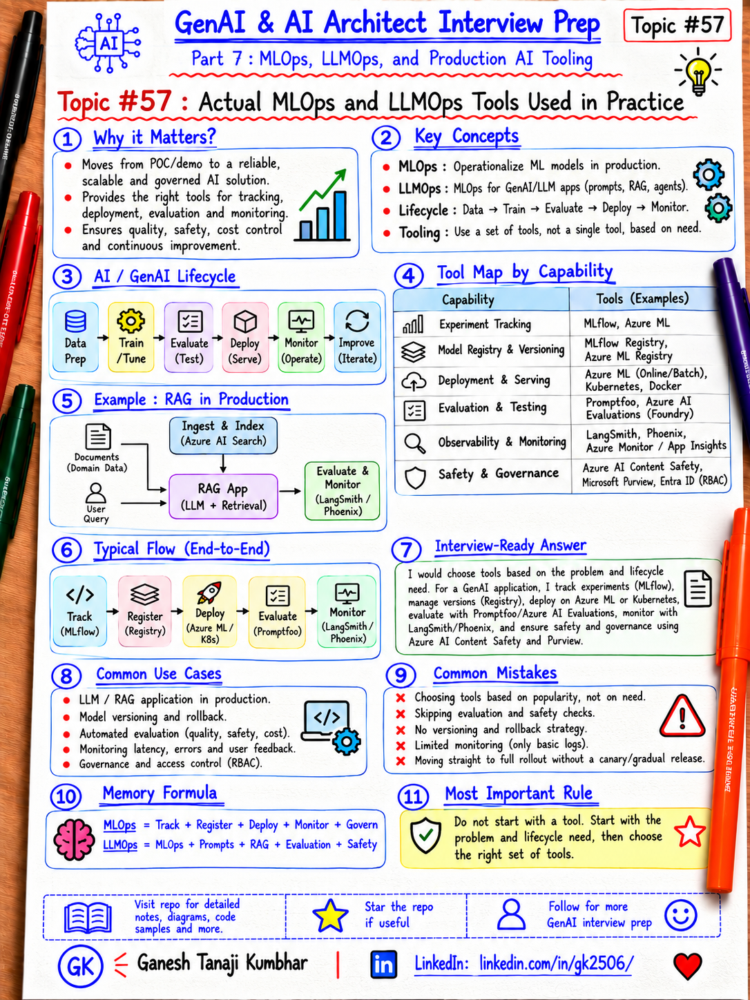

# GenAI & AI Architect Interview Prep

# Topic #57: Actual MLOps and LLMOps Tools Used in Practice



---

## Important Note: Continuing Part 7

We have already covered the MLOps and LLMOps lifecycle. Now the practical question is:

```text
Which tools are actually used to implement it?
```

This is an important interview topic because many candidates can explain concepts such as experiment tracking, model registry, RAG evaluation, tracing, and CI/CD, but struggle when asked:

```text
Which tool would you use?
Where does it sit?
What problem does it solve?
What does it NOT solve?
How does it integrate with the rest of the platform?
```

> A strong AI Architect should understand tool categories and integration boundaries, not just memorize product names.

---

## Question

You may be asked:

> Which MLOps tools have you used?

> Which tools would you choose for an enterprise ML platform?

> What do you use for LLM evaluation and observability?

> What is the role of MLflow, Azure ML, Microsoft Foundry, LangSmith, Phoenix, Promptfoo, or OpenTelemetry?

---

## Why Interviewer Asks This

A weak answer:

```text
We used MLflow, Azure ML, Kubernetes, LangChain, Grafana, and GitHub.
```

That is only a list.

A better answer explains:

```text
Tool
→ Responsibility
→ Integration
→ Ownership
→ Trade-off
```

Important line:

> Tool knowledge becomes useful when you can explain where the tool sits in the lifecycle.

---

## Basic Answer

A practical MLOps / LLMOps stack is normally composed of several categories:

```text
Source Control
→ CI/CD
→ Experiment Tracking
→ Registry
→ Data / Feature Management
→ Evaluation
→ Deployment
→ Observability
→ Security
→ Governance
```

Example Microsoft-oriented stack:

```text
GitHub / Azure Repos
      ↓
GitHub Actions / Azure Pipelines
      ↓
MLflow + Azure Machine Learning
      ↓
Model Registry
      ↓
Microsoft Foundry Evaluations
      ↓
Azure OpenAI + Azure AI Search
      ↓
Container Apps / AKS / Azure ML Endpoints
      ↓
Application Insights / Azure Monitor
      ↓
Key Vault + Microsoft Entra ID
```

> You do not need one product to solve every stage.

---

## Architect-Level Answer

> I choose tools by lifecycle responsibility rather than popularity. For classical ML, I may use MLflow for experiment tracking and lineage, Azure Machine Learning for managed training, registry and deployment, GitHub or Azure Repos for source control, and GitHub Actions or Azure Pipelines for CI/CD. For GenAI and agent systems, I add evaluation, tracing, RAG analysis, agent observability and red-team capabilities. Depending on the stack, that could include Microsoft Foundry evaluations, LangSmith, Arize Phoenix, Promptfoo, or custom evaluators. I prefer standard telemetry such as OpenTelemetry where practical and avoid overlapping products unless each one has a clear responsibility.

---

# Must Mention in Interview

## 1. Source Control

Typical tools:

```text
GitHub
Azure Repos
GitLab
Bitbucket
```

Version:

- Application code
- Training code
- Prompt templates
- Evaluation assets
- Agent configuration
- Tool schemas
- Infrastructure code
- Pipeline definitions

Important line:

> Source control should contain reproducible configuration, not secrets or mutable production state.

---

## 2. CI/CD

Typical tools:

```text
GitHub Actions
Azure Pipelines
GitLab CI
Jenkins
```

Responsibilities:

```text
Build
Test
Evaluate
Scan
Package
Register
Deploy
Approve
Rollback
```

> CI/CD is the orchestration layer connecting the other MLOps and LLMOps tools.

---

## 3. MLflow

MLflow is commonly used for:

```text
Experiment tracking
Parameters
Metrics
Artifacts
Datasets
Model lineage
Model registration
Model versions
```

Typical flow:

```text
Training Run
    ↓
MLflow Tracking
    ↓
Metrics + Parameters + Artifacts
    ↓
Model Registry
    ↓
Candidate Model
```

Important line:

> MLflow's real value is reproducibility and lineage, not only its UI.

---

## 4. Azure Machine Learning

Azure Machine Learning can provide:

```text
Managed training
Compute
MLflow integration
Model assets
Registry
Online endpoints
Batch endpoints
Pipelines
Identity integration
```

A useful Microsoft-stack pattern is:

```text
Azure ML = Managed Platform
MLflow   = Tracking / lifecycle interface
```

Important line:

> MLflow and Azure ML can complement each other instead of being treated as competing tools.

---

## 5. Model Registry

Common choices include:

```text
MLflow Model Registry
Azure Machine Learning model assets / registry
Databricks Unity Catalog
Other managed registries
```

The registry should answer:

```text
Which model is production?
Which run produced it?
Which version was approved?
Which version can we roll back to?
```

> A registry is a governance and traceability component, not just file storage.

---

## 6. Data and Feature Management

Possible data-versioning approaches:

```text
DVC
lakeFS
Delta / lakehouse versioning
Immutable cloud-storage versions
```

Feature-store examples:

```text
Feast
Azure / Databricks feature-store capabilities
Custom enterprise feature services
```

Important line:

> The objective is reproducibility and consistency; not every project needs a feature store.

---

# LLMOps Tools

## 7. Microsoft Foundry Evaluations

Microsoft Foundry can support evaluation of:

```text
Models
RAG applications
Agents
Conversation traces
Existing datasets
Synthetic scenarios
```

Typical flow:

```text
Candidate Change
→ Evaluate
→ Compare
→ Quality Gate
→ Release
```

Useful when your platform already contains Azure OpenAI, Azure AI Search, agents, and Azure monitoring.

> Platform-native evaluation can reduce integration effort, but your evaluation criteria should remain portable.

---

## 8. LangSmith

LangSmith is often used in LangChain / LangGraph environments for:

```text
Tracing
Datasets
Experiments
Offline evaluation
Online evaluation
Regression testing
Production feedback
```

Useful trace:

```text
Prompt
→ Retrieval
→ LLM
→ Tool
→ Agent Steps
→ Final Answer
```

> LLM observability is about seeing the execution path, not only the final response.

---

## 9. Arize Phoenix

Phoenix is an open-source AI observability and evaluation platform.

Useful for:

```text
Tracing
Prompt analysis
RAG analysis
Evaluations
Datasets
Experiments
Agent troubleshooting
```

It works with standards such as:

```text
OpenTelemetry
OpenInference
```

> Open tracing standards can reduce observability lock-in.

---

## 10. Promptfoo

Promptfoo is useful for:

```text
Prompt evaluation
Regression testing
Model comparison
Red teaming
Prompt injection testing
Jailbreak testing
PII leak testing
Agent / tool security testing
```

Typical flow:

```text
Prompt / Agent Change
      ↓
Automated Tests
      ↓
Evaluation + Red Team
      ↓
Pass / Fail
```

> Prompt and agent testing should be repeatable enough to run inside CI/CD.

---

## 11. Weights & Biases / Weave

The W&B ecosystem can support areas such as:

```text
Experiment tracking
Model-development workflows
LLM tracing
Evaluation
Application iteration
```

Architectural lesson:

> Avoid creating multiple competing systems of record for the same experiment or evaluation data.

---

# Observability

## 12. OpenTelemetry

OpenTelemetry standardizes:

```text
Traces
Metrics
Logs
Context propagation
```

A GenAI trace may look like:

```text
User Request
→ API
→ Retrieval
→ LLM
→ Agent
→ Tool
→ Database
```

> OpenTelemetry is instrumentation and telemetry plumbing, not the monitoring dashboard itself.

---

## 13. OpenInference

OpenInference adds AI-oriented tracing concepts for:

```text
LLM calls
Prompts
Retrieval
Embeddings
Tool calls
Agent steps
```

Useful when standardizing AI traces across tooling.

---

## 14. Application Insights and Azure Monitor

Useful for:

```text
Application telemetry
Dependencies
Failures
Latency
Distributed tracing
Dashboards
Alerts
Custom metrics
```

Add AI-specific fields such as:

```text
promptVersion
modelVersion
indexVersion
retrievalLatency
toolName
tokenUsage
cost
qualityScore
taskSuccess
```

> Traditional APM plus AI-specific telemetry gives the useful production picture.

---

## 15. Prometheus and Grafana

Commonly used for platform and infrastructure monitoring:

```text
CPU
Memory
GPU
Request rate
Latency
Queue depth
Container health
Kubernetes metrics
```

Especially useful for:

```text
AKS / Kubernetes
GPU workloads
Self-hosted inference
```

> Infrastructure monitoring does not automatically measure AI quality.

---

# Deployment Tools

## 16. Azure ML Managed Endpoints

Useful for:

```text
Managed model inference
Online endpoints
Batch endpoints
Versioned deployments
Traffic splitting
```

Example:

```text
Model v12 → 95%
Model v13 → 5%
```

---

## 17. Azure Container Apps

Useful for containerized:

- RAG APIs
- Agent services
- Background workers
- Lightweight inference APIs

Good when autoscaling is required without full Kubernetes operational overhead.

---

## 18. AKS / Kubernetes

Useful when you genuinely need:

```text
GPU scheduling
Advanced networking
Custom scaling
Multiple services
Platform control
Service mesh
```

Trade-off:

```text
More flexibility
=
More operational responsibility
```

> Do not choose Kubernetes just because the workload contains AI.

---

# RAG and Agent Tools

## 19. Azure AI Search

Useful for:

```text
Vector search
Keyword search
Hybrid search
Semantic ranking
Metadata filtering
```

RAG flow:

```text
Documents
→ Chunk
→ Embed
→ Index
→ Retrieve
→ Rerank
→ Generate
```

> Search quality should be evaluated independently from generation quality.

---

## 20. Vector Databases

Examples:

```text
Pinecone
Weaviate
Qdrant
Milvus
PostgreSQL + pgvector
```

Choose based on:

```text
Scale
Latency
Filtering
Operations
Cloud alignment
Cost
Governance
```

---

## 21. Semantic Kernel

Relevant in Microsoft-centric application stacks for:

```text
Model integration
Prompt orchestration
Plugins / tools
Agent patterns
.NET and Python applications
```

---

## 22. LangGraph / LangChain

Commonly used for:

```text
LLM workflows
Agent graphs
Stateful agents
Tool orchestration
Retrieval pipelines
```

Important line:

> A framework does not remove the need to design authorization, retries, state, tracing, and failure handling.

---

# Security, Identity, and Infrastructure

## 23. Azure Key Vault

Use for:

```text
Secrets
API keys
Certificates
Connection strings
```

Prefer managed identities where supported.

---

## 24. Microsoft Entra ID

Use for:

```text
Authentication
Managed identity
Workload identity
RBAC
Service-to-service access
```

Agent principle:

```text
User
→ Application
→ Agent
→ Tool
```

The agent should never bypass the user's authorization boundary.

---

## 25. Infrastructure as Code

Typical tools:

```text
Bicep
Terraform
Pulumi
ARM
```

Manage:

```text
AI services
Networking
Storage
Compute
Identity
Monitoring
Search
```

> Reproducible AI environments require reproducible infrastructure.

---

# Practical End-to-End Microsoft Stack

One possible architecture:

```text
GitHub / Azure Repos
        ↓
Azure Pipelines / GitHub Actions
        ↓
┌─────────────────────────────┐
│ Classical ML                │
│ Azure ML + MLflow           │
│ Model Registry              │
│ Online / Batch Endpoint     │
└─────────────────────────────┘
        ↓
┌─────────────────────────────┐
│ GenAI / RAG / Agents        │
│ Azure OpenAI                │
│ Azure AI Search             │
│ Semantic Kernel             │
│ Foundry Eval / Promptfoo    │
└─────────────────────────────┘
        ↓
OpenTelemetry
        ↓
Application Insights / Azure Monitor
        ↓
Phoenix / LangSmith if deeper AI tracing is needed
        ↓
Entra ID + Managed Identity + Key Vault
```

This is only one valid stack.

> Good architecture minimizes overlap and makes ownership clear.

---

# Tool Selection Framework

Before adding a tool, ask:

```text
1. What exact problem does it solve?
2. Does our current platform already solve it?
3. Is it managed or self-hosted?
4. What data leaves our environment?
5. How does identity work?
6. Can it integrate with CI/CD?
7. Can telemetry be exported?
8. What is the operational cost?
9. What is the vendor lock-in?
10. Who will own it?
```

---

# Practical Interview Scenario 1

Interviewer:

> We already use Azure DevOps, Azure OpenAI, Azure AI Search, Application Insights, and AKS. Do we also need LangSmith?

Weak answer:

```text
Yes. LangSmith is good for LLMOps.
```

Better answer:

> I would first identify the observability gap. If Application Insights gives us normal application traces but we cannot easily inspect prompts, retrieval, agent steps, and tool execution, then a specialized LLM tracing platform may add value. I would compare LangSmith, Phoenix, and platform-native capabilities based on trace depth, evaluation support, data residency, integration, and operational overhead. I would not add another tool just because it is popular.

Important line:

> Architecture is often about deciding what NOT to add.

---

# Practical Interview Scenario 2

Interviewer:

> We already use MLflow. Do we still need Azure Machine Learning?

Better answer:

> They can solve different layers. MLflow can provide a consistent tracking and model-lifecycle interface, while Azure Machine Learning can provide managed compute, jobs, model assets, endpoints, identity, and broader Azure platform integration. In an Azure environment, MLflow can work through Azure Machine Learning rather than being treated as a completely separate platform.

---

# Tool Categories to Remember

```text
Code
→ GitHub / Azure Repos

CI/CD
→ GitHub Actions / Azure Pipelines

ML Tracking
→ MLflow

Managed ML Platform
→ Azure Machine Learning

GenAI Platform
→ Microsoft Foundry / Azure OpenAI

RAG
→ Azure AI Search / Vector DB

LLM Evaluation
→ Foundry / LangSmith / Phoenix / Promptfoo

Tracing Standard
→ OpenTelemetry / OpenInference

APM
→ Application Insights / Azure Monitor

Infra Monitoring
→ Prometheus / Grafana

Deployment
→ Azure ML Endpoints / Container Apps / AKS

Identity / Secrets
→ Entra ID / Managed Identity / Key Vault

Infrastructure
→ Bicep / Terraform
```

---

# What If You Have Not Used a Tool?

Do not claim production experience you do not have.

Bad:

```text
I have production experience with LangSmith.
```

if you only followed a tutorial.

Better:

> I have not used LangSmith in production, but I understand the problem it solves around LLM tracing and evaluation. In my environment, I used Application Insights and custom telemetry. If deeper agent or RAG traces were needed, I would evaluate specialized tools based on the gap.

> Credible experience is stronger than a long list of tool names.

---

# Common Mistakes

## Mistake 1: Listing Every Popular Tool

Without explaining responsibility or integration.

## Mistake 2: Multiple Sources of Truth

Example:

```text
MLflow tracks experiments
W&B tracks experiments
Azure ML tracks experiments
```

Which one is authoritative?

## Mistake 3: Treating a Framework as Architecture

LangChain or Semantic Kernel does not automatically solve:

```text
Security
Evaluation
Observability
Retries
Governance
```

## Mistake 4: Ignoring Existing Enterprise Platforms

Do not add a tool if the current platform already solves the need adequately.

## Mistake 5: No Data Residency Review

LLM observability may capture:

```text
Prompts
Responses
Retrieved documents
Tool parameters
User context
```

## Mistake 6: Tool First, Problem Second

Bad:

```text
We need Kubernetes.
```

Better:

```text
We need GPU scheduling and advanced orchestration.
Kubernetes is one possible solution.
```

---

# Better Interview Answer

> I do not think of MLOps and LLMOps as one product. I think in lifecycle capabilities. For source and CI/CD, I may use GitHub or Azure DevOps. For classical ML, MLflow is useful for experiment tracking, lineage, and model registration, while Azure Machine Learning can provide managed training, compute, model assets, and endpoints. For GenAI, I may use Microsoft Foundry evaluation capabilities plus specialized tools such as LangSmith or Phoenix where deeper LLM and agent tracing is required. Promptfoo is useful for repeatable prompt evaluation and red teaming. For production telemetry, I prefer standard instrumentation such as OpenTelemetry integrated with Application Insights, Azure Monitor, or another backend. The key is to avoid unnecessary overlap and choose tools based on actual operational gaps.

---

# One-Line Answer

> Choose MLOps and LLMOps tools by lifecycle responsibility — tracking, registry, evaluation, deployment, observability, security, and governance — not by how many product names you can list.

---

# Memory Formula

```text
MLOps Tools
= Track + Register + Deploy + Monitor

LLMOps Tools
= Version + Evaluate + Trace + Guard + Improve

Platform
= CI/CD + Identity + Infrastructure + Observability
```

Short interview memory:

```text
Problem
→ Capability
→ Tool
→ Integration
→ Ownership
```

Most important rule:

```text
Do not start with the tool.
Start with the operational problem you need to solve.
```

---

# Interview Closing Line

> I would rather explain why we need a tool, what responsibility it owns, and how it integrates with the platform than list ten MLOps products. The best stack is usually the smallest set of tools that gives us reliable lifecycle control, observability, security, and governance.

---

# Related Upcoming Topics

- MLOps vs LLMOps vs DevOps
- Responsible AI, Governance, and Release Controls

---

# Reference Scenario

Example mapping for the Expense Management AI system:

```text
Source
→ GitHub

CI/CD
→ Azure Pipelines

ML Tracking
→ MLflow / Azure ML

Fraud Model Registry
→ Azure ML / MLflow

RAG
→ Azure OpenAI + Azure AI Search

Agent Runtime
→ Semantic Kernel

Evaluation
→ Microsoft Foundry / Promptfoo

Tracing
→ OpenTelemetry

Application Monitoring
→ Application Insights

Identity
→ Entra ID / Managed Identity

Secrets
→ Key Vault

Deployment
→ Container Apps / AKS / Azure ML Endpoints
```

The broader scenario remains available here:

```text
00-common-examples/expense-management-ai-agent-scenario.md
```

---

## About the Author

These notes are created and maintained by **Ganesh Tanaji Kumbhar**, an **AI Architect** with experience in **.NET, Azure, cloud architecture, infrastructure, enterprise application modernization, and GenAI solution design**.

I bring practical experience across:

- **.NET / C# / ASP.NET / Web API**
- **Azure App Services, Azure Functions, WebJobs, Azure SQL, Storage, Redis**
- **Cloud architecture and infrastructure modernization**
- **Application architecture and enterprise system design**
- **CI/CD, DevOps, monitoring, and production support**
- **GenAI, RAG, Agentic AI, and AI architecture patterns**

These notes are based on my real experience as both:

- An **interviewee**, facing AI, architecture, cloud, .NET, Azure, and system design rounds
- An **interviewer**, evaluating how candidates explain concepts, tradeoffs, project experience, and real-world design decisions

I write about:

- GenAI Architecture
- RAG System Design
- Agentic AI
- AI Architect Interview Preparation
- .NET and Azure Architecture
- Cloud and Enterprise AI Patterns

If you are preparing for **GenAI / AI Architect / Staff Engineer / Solution Architect / .NET Architect / Azure Architect** interviews, feel free to connect with me on LinkedIn.

🔗 **LinkedIn:** [Connect with me on LinkedIn](https://www.linkedin.com/in/gk2506/)

💬 You can also DM me on LinkedIn if you want to discuss AI architecture, interview preparation, .NET/Azure architecture, or practical GenAI learning.
