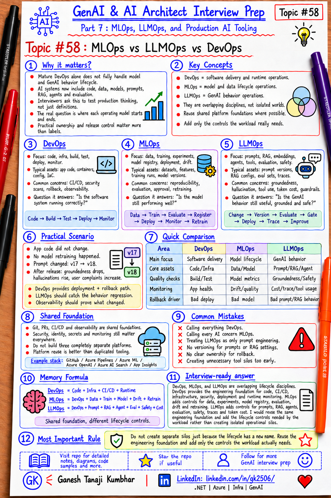

# GenAI & AI Architect Interview Prep

# Topic #58: MLOps vs LLMOps vs DevOps



---

## Important Note: Continuing Part 7

In the previous topics, we covered:

- MLOps fundamentals
- ML lifecycle
- Experiment tracking and model registry
- Data versioning and feature stores
- CI/CD for ML and GenAI
- Model deployment patterns
- Monitoring, drift, feedback, and retraining
- LLMOps for prompts, RAG, agents, and evaluation
- AI evaluation and quality gates
- Practical MLOps and LLMOps tools

Now we clarify an important production architecture question:

```text
Where does DevOps end?
Where does MLOps begin?
Where does LLMOps fit?
```

The mistake is to think of these as three completely separate worlds.

In practice, they overlap.

> DevOps provides the software delivery foundation, MLOps extends it for model and data lifecycle management, and LLMOps extends production operations further for prompts, RAG, agents, evaluation, safety, and GenAI behavior.

---

## Practical Incident-Style Scenario

Imagine this production incident:

```text
Application code did not change.
No model was retrained.
Infrastructure did not change.

But someone changed:
Prompt v17 → Prompt v18
```

After deployment:

```text
Groundedness drops
Hallucinations increase
User complaints rise
```

Who owns the rollback?

```text
DevOps?
MLOps?
LLMOps?
```

The useful answer is not simply one team name.

The real questions are:

```text
Which lifecycle artifact changed?
Who owns its release controls?
Which telemetry proves the regression?
How do we restore the previous known-good behavior?
```

This is exactly why the boundaries matter.

---

## Question

In an interview, you may be asked:

> What is the difference between DevOps, MLOps, and LLMOps?

> Is LLMOps just MLOps for LLMs?

> Do we need LLMOps if we already have mature DevOps and MLOps?

> Who owns prompt versioning, evaluation, and rollback?

> Where should RAG and agent evaluation sit in the delivery lifecycle?

---

## Why Interviewer Asks This

A weak answer:

```text
DevOps = software
MLOps = machine learning
LLMOps = LLMs
```

Technically, that is not wrong.

But it is too shallow for an architecture discussion.

The interviewer usually wants to know whether you understand:

- Lifecycle boundaries
- Shared responsibilities
- Versioned artifacts
- Release controls
- Evaluation
- Observability
- Rollback
- Ownership
- Governance
- Production operations

> The difference is not only the technology being deployed; it is the lifecycle that must be controlled.

---

## Basic Answer

### DevOps

Focuses mainly on:

```text
Application Code
Infrastructure
Build
Test
Deploy
Operate
Monitor
```

Typical loop:

```text
Code
→ Build
→ Test
→ Deploy
→ Monitor
```

### MLOps

Extends DevOps for ML-specific assets:

```text
Code
+ Data
+ Features
+ Training
+ Experiments
+ Model
+ Evaluation
+ Registry
+ Deployment
+ Drift
+ Retraining
```

Typical loop:

```text
Data
→ Train
→ Evaluate
→ Register
→ Deploy
→ Monitor
→ Retrain
```

### LLMOps

Extends production operations for GenAI behavior:

```text
Code
+ Prompt
+ Model Configuration
+ RAG
+ Embeddings
+ Index
+ Agent Instructions
+ Tools
+ Evaluation Data
+ Safety
+ Cost
+ Traces
+ Feedback
```

Typical loop:

```text
Change
→ Version
→ Evaluate
→ Gate
→ Deploy
→ Trace
→ Monitor
→ Improve
```

---

## Architect-Level Answer

> I see DevOps, MLOps, and LLMOps as overlapping lifecycle disciplines rather than separate delivery systems. DevOps gives us source control, CI/CD, infrastructure automation, security scanning, deployment, and operational monitoring. MLOps adds data and model lifecycle concerns such as experiment tracking, feature management, model registry, model evaluation, drift monitoring, and retraining. LLMOps adds GenAI-specific behavior management such as prompt versioning, RAG configuration, evaluation datasets, groundedness and hallucination checks, agent and tool tracing, token cost, safety evaluation, and rollback of AI configuration. I would avoid building three isolated platforms; instead, I would extend the existing engineering platform with the lifecycle controls that the workload actually requires.

---

## Must Mention in Interview

### 1. DevOps Is the Foundation

DevOps still handles many shared concerns:

```text
Git
Pull Requests
Build
Unit Tests
Security Scans
Infrastructure as Code
Deployment Pipelines
Secrets Integration
Observability
Rollback
```

> MLOps and LLMOps do not replace DevOps; they build on it.

### 2. MLOps Adds Model and Data Lifecycle

MLOps adds:

```text
Training Dataset
Feature Definitions
Experiment Runs
Hyperparameters
Metrics
Model Version
Model Registry
Model Approval
Drift
Retraining
```

Example:

```text
FraudModel v12
```

should be traceable to:

```text
Dataset v7
Training Code Commit
Feature Version
Experiment Run
Evaluation Result
Approval
Production Deployment
```

> A model is not just another binary artifact; it is the result of data, training code, features, parameters, and evaluation.

### 3. LLMOps Adds Behavioral Configuration

GenAI behavior can change without retraining a model.

Examples:

```text
Prompt v17 → v18
Top-K 5 → 8
Embedding model changed
Chunk size changed
Reranker added
Agent tool added
System instruction changed
Safety policy changed
```

> In GenAI, configuration changes can be production behavior changes.

### 4. Prompt Versioning

Track:

```text
Prompt Name
Prompt Version
Owner
Change Reason
Evaluation Result
Approval
Release
Rollback Version
```

Better flow:

```text
Version
→ Evaluate
→ Review
→ Deploy
→ Monitor
→ Rollback if needed
```

### 5. RAG Lifecycle

RAG behavior depends on:

```text
Document Version
Chunking
Embedding Model
Index Version
Metadata Filters
Top-K
Hybrid Search
Reranker
Generation Prompt
```

> RAG needs retrieval evaluation in addition to software deployment checks.

### 6. Agents Add Action Risk

Agents introduce:

```text
Tool selection
Tool parameters
Permissions
Retries
Loops
Approvals
State
Escalation
```

> LLMOps for agents must evaluate not only answers, but actions.

---

## Comparison Table

| Area | DevOps | MLOps | LLMOps |
|---|---|---|---|
| Main focus | Software delivery | ML model lifecycle | GenAI behavior lifecycle |
| Code versioning | Yes | Yes | Yes |
| Infrastructure | Yes | Yes | Yes |
| CI/CD | Yes | Yes | Yes |
| Dataset versioning | Limited | Core concern | Important for eval/RAG |
| Experiment tracking | No | Core concern | Sometimes |
| Model registry | No | Core concern | May apply |
| Prompt versioning | No | Usually not central | Core concern |
| RAG evaluation | No | Usually not central | Core concern |
| Agent/tool evaluation | No | No | Core concern |
| Drift monitoring | App/runtime | Data/model drift | Behavior/quality drift |
| Cost tracking | Infra/app cost | Training/inference cost | Token/tool/workflow cost |
| Safety evaluation | Security focused | Model risk | Prompt/RAG/agent safety |
| Retraining | No | Core concern | Sometimes |
| Feedback loop | Operational | Model improvement | Prompt/RAG/agent improvement |

> The exact boundary depends on the architecture and organization.

---

## Practical Ownership Model

A good enterprise design may look like:

```text
Platform / DevOps Team
→ CI/CD
→ Infrastructure
→ Runtime
→ Networking
→ Shared observability
→ Security tooling

ML Platform / Data Science
→ Experiments
→ Training
→ Features
→ Model registry
→ Model evaluation
→ Drift / retraining

GenAI / Application Team
→ Prompt versions
→ RAG configuration
→ Agent behavior
→ Tool contracts
→ GenAI evaluations
→ Safety / cost / traces
```

> Architecture should define responsibilities clearly without creating isolated operational silos.

---

## Practical Scenario: Prompt Regression

Production system:

```text
Application v3.4
Prompt v17
RAG Index v8
Model Config v5
```

A release changes:

```text
Prompt v17 → v18
```

No application code changed.

After release:

```text
Groundedness:
94% → 86%

Hallucination:
2% → 7%
```

Best framing:

```text
DevOps
→ provides deployment / rollback mechanism

LLMOps
→ owns prompt evaluation and behavioral gate

Observability
→ proves the regression

Release governance
→ defines who can approve / rollback
```

> The incident crosses disciplines; the ownership model should make the response obvious.

---

## Practical Scenario: Model Retraining

Current:

```text
FraudModel v12
```

Monitoring detects:

```text
Recall degradation
Data drift
```

Flow:

```text
Detect Drift
→ Investigate
→ Retrain
→ Evaluate
→ Register v13
→ Approve
→ Canary
→ Promote
```

This is primarily an MLOps lifecycle.

DevOps still provides:

```text
Pipeline
Infrastructure
Deployment automation
Secrets
Monitoring platform
```

---

## Practical Scenario: RAG Index Change

Change:

```text
Chunk Size 500 → 900
Top-K 5 → 8
```

Result:

```text
Recall improves
Latency increases
Cost increases
Groundedness changes
```

This is a strong LLMOps example because the behavior changed through retrieval configuration, not application code or model retraining.

---

## When DevOps Alone May Be Enough

For a simple GenAI application:

```text
Single prompt
No RAG
No agents
Low risk
Small traffic
Manual review
```

you may not need a large dedicated LLMOps platform.

You may extend existing DevOps with:

```text
Prompt versioning
Basic evaluation
Telemetry
Cost tracking
```

> Do not introduce a new platform unless the lifecycle complexity justifies it.

---

## When MLOps Becomes Necessary

MLOps becomes increasingly important when you have:

```text
Custom model training
Frequent retraining
Large datasets
Feature pipelines
Multiple experiments
Model registry
Drift monitoring
Champion-challenger
```

---

## When LLMOps Becomes Necessary

LLMOps controls become increasingly important when you have:

```text
Frequent prompt changes
RAG
Multiple models
Agents
Tool calling
Evaluation datasets
Safety requirements
Prompt injection risk
Cost constraints
Complex traces
```

> LLMOps is less about creating another team and more about adding the controls needed for GenAI behavior.

---

## Release Artifacts

### DevOps Release

```text
Code
Container
Infrastructure
Configuration
```

### MLOps Release

```text
Code
Dataset
Features
Training Run
Model
Evaluation
```

### LLMOps Release

```text
Code
Prompt
Model Config
RAG Config
Index
Agent
Tools
Evaluation Dataset
Safety Policy
```

---

## Quality Gates

### DevOps Gates

```text
Build passes
Tests pass
Security scan passes
Deployment succeeds
```

### MLOps Gates

```text
Model quality threshold
Data validation
Bias / segment checks
Latency
Model approval
```

### LLMOps Gates

```text
Groundedness
Hallucination
Retrieval quality
Tool accuracy
Safety
Latency
Token cost
Task success
```

> A green software pipeline does not automatically mean the AI release is good.

---

## Monitoring

### DevOps

```text
Availability
CPU
Memory
Latency
Errors
Dependencies
```

### MLOps

```text
Data drift
Feature drift
Prediction drift
Precision
Recall
Model quality
```

### LLMOps

```text
Groundedness
Hallucination
Retrieval success
Tool-call accuracy
Agent loops
Token usage
Cost
User feedback
```

---

## Microsoft-Stack View

A practical Microsoft-oriented setup may be:

```text
DevOps Foundation
→ GitHub / Azure Repos
→ Azure Pipelines / GitHub Actions
→ Bicep / Terraform

MLOps
→ Azure Machine Learning
→ MLflow
→ Model Registry
→ Managed Endpoints

LLMOps
→ Microsoft Foundry
→ Azure OpenAI
→ Azure AI Search
→ Evaluation
→ Agent / RAG tracing

Shared Operations
→ OpenTelemetry
→ Application Insights
→ Azure Monitor
→ Entra ID
→ Managed Identity
→ Key Vault
```

> Reuse the shared platform where possible instead of building separate operational stacks.

---

## Common Mistakes

### Mistake 1: Treating Them as Three Separate Platforms

This creates:

```text
Duplicate pipelines
Duplicate monitoring
Duplicate governance
More cost
More ownership confusion
```

### Mistake 2: Calling Everything MLOps

Prompt evaluation and agent traces are not the same as model retraining.

### Mistake 3: Calling Everything DevOps

A deployment can be technically successful while AI behavior regresses.

### Mistake 4: Introducing LLMOps Tools Too Early

Do not build a complex platform for a tiny low-risk prototype unless needed.

### Mistake 5: No Clear Ownership

If prompt quality drops:

```text
Who investigates?
Who rolls back?
Who approves the next release?
```

These answers should already be known.

### Mistake 6: Manual Prompt Changes in Production

This breaks:

```text
Traceability
Evaluation
Approval
Rollback
```

---

## Better Interview Answer

> DevOps, MLOps, and LLMOps are overlapping lifecycle disciplines. DevOps gives us the engineering foundation for code, CI/CD, infrastructure, deployment, security, and runtime monitoring. MLOps adds controls for datasets, features, experiments, model registry, evaluation, drift, and retraining. LLMOps adds controls for prompts, RAG configuration, embeddings, agents, tools, evaluation datasets, groundedness, safety, traces, token cost, and GenAI-specific rollback. I would not build three isolated platforms. I would extend the existing DevOps foundation with MLOps and LLMOps capabilities based on the actual workload and risk.

---

## One-Line Answer

> DevOps operates software, MLOps operates the model lifecycle, and LLMOps operates GenAI behavior — with all three sharing the same production engineering foundation.

---

## Memory Formula

```text
DevOps
= Code + Infra + CI/CD + Runtime

MLOps
= DevOps + Data + Train + Model + Drift + Retrain

LLMOps
= DevOps + Prompt + RAG + Agent + Eval + Safety + Cost
```

Another useful memory:

```text
DevOps
→ Is the system running?

MLOps
→ Is the model still performing?

LLMOps
→ Is the GenAI behavior still useful, grounded, safe, and cost-effective?
```

---

## Most Important Rule

```text
Do not create separate operational silos just because the lifecycle has a new name.

Reuse the engineering foundation and add the controls the workload actually needs.
```

---

## Interview Closing Line

> I would define the boundaries by lifecycle responsibility rather than team names. If application code changes, DevOps controls apply. If data or models change, MLOps controls become important. If prompts, retrieval, agents, tools, or GenAI behavior change, LLMOps evaluation and governance become important. In production, these disciplines should work together rather than operate as disconnected platforms.

---

## Related Upcoming Topic

- Responsible AI, Governance, and Release Controls

After Topic #59, the series moves into:

```text
Part 8: Interview Answer Frameworks
```

starting with:

```text
How Would You Design an Agentic AI System?
```

---

## Reference Scenario

The Expense Management AI system can contain all three disciplines:

```text
DevOps
→ API / infrastructure deployment

MLOps
→ Fraud detection model lifecycle

LLMOps
→ Expense Agent + Policy RAG + Prompt + Evaluation
```

The broader scenario remains available here:

```text
00-common-examples/expense-management-ai-agent-scenario.md
```

---

## About the Author

These notes are created and maintained by **Ganesh Tanaji Kumbhar**, an **AI Architect** with experience in **.NET, Azure, cloud architecture, infrastructure, enterprise application modernization, and GenAI solution design**.

I bring practical experience across:

- **.NET / C# / ASP.NET / Web API**
- **Azure App Services, Azure Functions, WebJobs, Azure SQL, Storage, Redis**
- **Cloud architecture and infrastructure modernization**
- **Application architecture and enterprise system design**
- **CI/CD, DevOps, monitoring, and production support**
- **GenAI, RAG, Agentic AI, and AI architecture patterns**

These notes are based on my real experience as both:

- An **interviewee**, facing AI, architecture, cloud, .NET, Azure, and system design rounds
- An **interviewer**, evaluating how candidates explain concepts, tradeoffs, project experience, and real-world design decisions

I write about:

- GenAI Architecture
- RAG System Design
- Agentic AI
- AI Architect Interview Preparation
- .NET and Azure Architecture
- Cloud and Enterprise AI Patterns

If you are preparing for **GenAI / AI Architect / Staff Engineer / Solution Architect / .NET Architect / Azure Architect** interviews, feel free to connect with me on LinkedIn.

🔗 **LinkedIn:** [Connect with me on LinkedIn](https://www.linkedin.com/in/gk2506/)

💬 You can also DM me on LinkedIn if you want to discuss AI architecture, interview preparation, .NET/Azure architecture, or practical GenAI learning.
