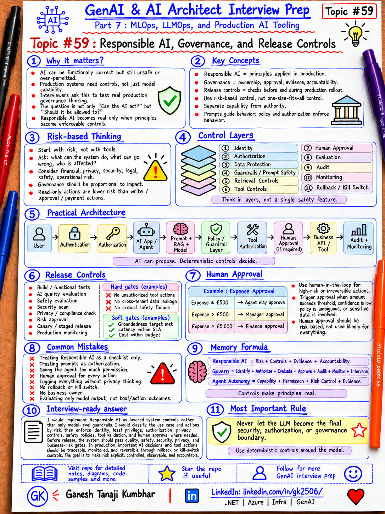

# GenAI & AI Architect Interview Prep

# Topic #59: Responsible AI, Governance, and Release Controls



---

## Important Note: Final Topic in Part 7

In the previous topics, we covered:

- MLOps fundamentals
- ML lifecycle
- Experiment tracking and model registry
- Data versioning and feature stores
- CI/CD for ML and GenAI
- Model deployment patterns
- Monitoring, drift, feedback, and retraining
- LLMOps for prompts, RAG, agents, and evaluation
- AI evaluation and quality gates
- Practical MLOps and LLMOps tools
- MLOps vs LLMOps vs DevOps

This topic closes Part 7 by answering a critical production question:

```text
The AI system works.

But should it be allowed to do what it is capable of doing?
```

That is where Responsible AI, governance, and release controls become essential.

---

## Practical Production Scenario

Imagine this system:

```text
AI Agent
→ Reads expense details
→ Checks company policy
→ Selects an approval tool
→ Sends correct parameters
→ Produces the expected result
```

All functional tests pass.

But the same tool can approve:

```text
£20 expense
£2,000 expense
£20,000 expense
```

The architecture question is no longer:

```text
Can the agent call the tool?
```

It becomes:

```text
Should the agent be allowed to call it?
For which users?
For which amounts?
Under which conditions?
With which approval?
With which audit trail?
How do we stop it immediately if something goes wrong?
```

> Responsible AI is not only about what the model says. It is also about what the system is allowed to do.

---

## Question

In an interview, you may be asked:

> How would you implement Responsible AI in a production GenAI system?

> What governance controls would you apply before releasing an AI agent?

> How do you decide whether an AI action should require human approval?

> What release controls are needed for RAG and agentic AI?

> How would you prevent an AI system from taking high-risk actions autonomously?

---

## Why Interviewer Asks This

A weak answer usually lists:

```text
Fairness
Transparency
Privacy
Safety
```

Those are important principles.

But for an architect-level answer, the interviewer wants to know how those principles become:

```text
Architecture
Permissions
Policies
Evaluation
Approval
Audit
Monitoring
Rollback
Operational controls
```

> Responsible AI becomes real only when principles are converted into enforceable system controls.

---

## Basic Answer

A production Responsible AI approach should cover:

```text
Identity
Authorization
Data Protection
Safety
Human Oversight
Evaluation
Auditability
Monitoring
Release Control
Rollback
```

A simple lifecycle is:

```text
Design
→ Assess Risk
→ Implement Controls
→ Evaluate
→ Approve
→ Release
→ Monitor
→ Intervene
→ Improve
```

---

## Architect-Level Answer

> I treat Responsible AI as a system-level engineering responsibility rather than only a model property. I would first classify the use case and actions by risk, then design controls around identity, least-privilege authorization, data protection, safety, human approval, auditability, evaluation, and monitoring. Low-risk read-only actions may be fully automated, while higher-risk write or financial actions may require additional authorization or human approval. Before release, the system should pass quality, safety, security, privacy, and business-risk gates. After release, every important decision or tool action should be traceable, monitored, and reversible, with rollback or kill-switch mechanisms available if behaviour becomes unsafe or unacceptable.

---

## Must Mention in Interview

### 1. Start with Risk, Not Technology

Do not begin with:

```text
Which Responsible AI tool should we use?
```

Start with:

```text
What can this AI system do?
What can go wrong?
Who could be affected?
What is the impact if it is wrong?
Can the action be reversed?
```

Risk dimensions may include:

```text
Financial
Privacy
Security
Legal
Safety
Operational
Reputational
Customer impact
```

> Governance should be proportional to the risk of the decision or action.

### 2. Separate Read Risk from Action Risk

Example:

```text
GetExpense
→ Read-only
→ Lower risk

RecommendApproval
→ Advisory
→ Medium risk

ApproveExpense
→ Write action
→ Higher risk

TransferPayment
→ Financial action
→ Very high risk
```

> An agent that can read data should not automatically be trusted to change data.

### 3. Identity and Least Privilege

The AI agent should operate using a clearly defined workload identity.

In Azure environments, prefer:

```text
Microsoft Entra ID
Managed Identity
RBAC
```

where supported.

Avoid:

```text
Shared admin accounts
Hard-coded secrets
Long-lived credentials
Over-privileged service identities
```

> Agent identity should be treated like any other production workload identity.

### 4. Authorization Must Be Enforced Outside the LLM

Bad design:

```text
Prompt:
"You are only allowed to approve expenses below £500."
```

Better:

```text
Agent
→ Requests ApproveExpense(£850)

Policy / Application Layer
→ Checks limit
→ Rejects or requests approval
```

> Prompts guide behaviour; authorization controls enforce behaviour.

### 5. Human-in-the-Loop for High-Risk Decisions

Human approval may be needed when:

```text
Amount exceeds threshold
Confidence is low
Policy is ambiguous
Sensitive data is involved
Irreversible action is requested
Regulated decision is involved
Exception is requested
```

Example:

```text
Expense <= £500
→ Agent may approve

Expense > £500
→ Manager approval

Expense > £5,000
→ Finance approval
```

> Human-in-the-loop should be risk-based, not added blindly to every AI action.

### 6. Auditability and Traceability

For an important AI action, you should be able to reconstruct:

```text
Who initiated the request?
Which user / tenant?
Which model was used?
Which prompt version?
Which RAG configuration?
Which documents were retrieved?
Which tool was selected?
Which parameters were sent?
What authorization was applied?
Was human approval required?
What was the final outcome?
```

Avoid logging sensitive content unnecessarily.

> Auditability is about reconstructing why and how an AI-driven action happened.

### 7. Safety Controls

Depending on the system, safety controls may include:

```text
Input filtering
Output filtering
Prompt-injection defenses
Content safety
Tool allow-lists
Parameter validation
Rate limits
Loop limits
Timeouts
Approval thresholds
Data-loss prevention
```

For agents:

```text
Model proposes action
→ Policy layer validates
→ Tool contract validates
→ Authorization validates
→ Action executes
```

> The LLM should never be the only safety boundary.

### 8. Privacy and Data Protection

Ask:

```text
What data is sent to the model?
Is PII involved?
Is sensitive data necessary?
Where is data stored?
What is retained?
Who can access logs?
Can data be minimized or redacted?
```

Useful controls:

```text
Data minimization
Redaction / masking
Tenant isolation
Encryption
Access control
Retention policy
Private networking where justified
```

### 9. Evaluation Before Release

A release should not depend only on:

```text
Build passed
Deployment succeeded
```

Evaluate:

```text
Correctness
Groundedness
Hallucination
Safety
Retrieval quality
Tool selection
Tool parameter accuracy
Authorization behaviour
Latency
Cost
Task completion
```

> A technically successful deployment can still be an unsafe AI release.

### 10. Release Gates

A practical release gate may look like:

```text
Build
→ Unit / Integration Tests
→ AI Evaluation
→ Safety Evaluation
→ Security Scan
→ Privacy Check
→ Risk Approval
→ Canary / Controlled Release
→ Production Monitoring
```

Example hard gates:

```text
No unauthorized tool actions
No critical safety failures
No cross-tenant data leakage
No high-severity security findings
```

Example soft gates:

```text
Groundedness >= target
Latency within SLA
Cost within budget
User acceptance acceptable
```

---

## Responsible AI Control Layers

A useful architecture model:

```text
1. Identity
2. Authorization
3. Data Protection
4. Prompt / Model Guardrails
5. Retrieval Controls
6. Tool Controls
7. Human Approval
8. Evaluation
9. Audit
10. Monitoring
11. Rollback / Kill Switch
```

Think of these as layers, not a single safety feature.

---

## Practical Architecture

```text
User
  ↓
Authentication
  ↓
Authorization
  ↓
AI Application / Agent
  ↓
Prompt + RAG + Model
  ↓
Policy / Guardrail Layer
  ↓
Tool Authorization
  ↓
Human Approval (if required)
  ↓
Business API / Tool
  ↓
Audit + Monitoring
```

> The AI can propose an action, but deterministic controls should decide whether the action is allowed.

---

## Example: Expense Approval Agent

User asks:

```text
Approve expense EXP-7890
```

Agent evaluates:

```text
Amount: £850
Policy limit: £500
Receipt: Present
Manager exception: Required
```

Agent proposes:

```text
ApproveExpense
```

Policy layer responds:

```text
Autonomous approval threshold exceeded.
Human approval required.
```

Flow:

```text
Agent Recommendation
→ Manager Approval
→ Tool Execution
→ Audit Log
```

---

## Governance Model

Governance should answer:

```text
Who can build?
Who can approve?
Who can deploy?
Who can change prompts?
Who can change tools?
Who can increase autonomous limits?
Who can view audit logs?
Who can disable the system?
```

Typical roles may include:

```text
Application Team
AI / ML Team
Security
Risk / Compliance
Business Owner
Platform Team
Operations
```

> Governance is partly technical and partly organizational.

---

## Change Governance

Treat these as production changes:

```text
Prompt change
Model change
Embedding model change
RAG chunking change
Top-K change
Reranker change
Agent instruction change
Tool addition
Tool permission change
Approval threshold change
Safety policy change
```

Each may need:

```text
Version
Evaluation
Review
Approval
Release
Monitoring
Rollback
```

---

## Release Strategies

For higher-risk AI changes, consider:

```text
Feature Flag
Canary
Shadow
Limited User Group
Read-only mode
Human-supervised mode
Progressive autonomy
```

Example:

```text
Phase 1
→ Agent recommends only

Phase 2
→ Agent executes low-risk actions

Phase 3
→ Agent executes medium-risk actions with approval

Phase 4
→ Expand autonomy only if evidence supports it
```

> Increase autonomy progressively as evidence and controls improve.

---

## Kill Switch and Rollback

A production AI system should support fast intervention.

Possible controls:

```text
Disable agent actions
Disable specific tool
Force read-only mode
Revert prompt
Revert model
Revert RAG configuration
Lower autonomous threshold
Require human approval for all actions
```

> If the AI can take consequential actions, operations must have a fast way to stop those actions.

---

## Monitoring After Release

Monitor:

```text
Safety violations
Unauthorized attempts
Human override rate
Escalation rate
Tool failures
Agent loops
Groundedness
Hallucination
Cost
Latency
User complaints
Business outcomes
```

Especially useful:

```text
Agent recommendation
vs
Human final decision
```

This helps determine whether autonomy should be expanded or reduced.

---

## Feedback Loop

```text
Production Event
→ Review
→ Root Cause
→ Add Evaluation Case
→ Improve Control
→ Re-test
→ Release
```

> Every serious AI incident should become a regression test or governance improvement.

---

## Responsible AI vs AI Safety vs Governance

### Responsible AI

Broad principles and practices around:

```text
Fairness
Reliability
Safety
Privacy
Inclusiveness
Transparency
Accountability
```

### AI Safety

Focuses on preventing harmful or unacceptable system behaviour.

Examples:

```text
Unsafe output
Unauthorized action
Prompt injection
Tool misuse
Runaway agent loop
```

### AI Governance

Defines:

```text
Policies
Ownership
Approval
Evidence
Audit
Risk management
Release controls
Accountability
```

Simple memory:

```text
Responsible AI
→ What should good AI look like?

Safety
→ How do we prevent harm?

Governance
→ Who decides, controls, approves, and proves it?
```

---

## Microsoft-Stack View

A practical Microsoft-oriented architecture may use:

```text
Identity
→ Microsoft Entra ID
→ Managed Identity
→ RBAC

Secrets
→ Azure Key Vault

AI Runtime
→ Azure OpenAI
→ Microsoft Foundry

RAG
→ Azure AI Search

Safety
→ Azure AI Content Safety
→ Application guardrails
→ Tool policies

Observability
→ OpenTelemetry
→ Application Insights
→ Azure Monitor

Governance
→ Azure Policy
→ Microsoft Purview where relevant
→ CI/CD approvals
→ Environment controls

Deployment
→ Azure Pipelines / GitHub Actions
→ Feature flags / staged rollout
```

> No single Microsoft service replaces the need for end-to-end governance design.

---

## Common Mistakes

### Mistake 1: Treating Responsible AI as a Checklist

Principles without architecture controls do not protect production systems.

### Mistake 2: Trusting the Prompt as Authorization

```text
"Never approve above £500"
```

is not a security boundary.

### Mistake 3: Giving the Agent Too Much Permission

Avoid:

```text
Agent identity = broad admin role
```

Prefer:

```text
Least privilege
Specific tools
Specific actions
Specific scopes
```

### Mistake 4: Human Approval for Everything

This may destroy the value of automation.

Use risk-based thresholds.

### Mistake 5: Logging Everything

More logging can create privacy and security risk.

Log what is needed for:

```text
Debugging
Audit
Security
Governance
```

without unnecessarily storing sensitive content.

### Mistake 6: No Rollback Strategy

If:

```text
Prompt v18
```

creates unsafe behaviour, you need a quick path back to:

```text
Prompt v17
```

### Mistake 7: No Business Owner

Technical teams should not decide financial, regulatory, or business-risk thresholds alone.

### Mistake 8: Evaluating Only Model Output

For agents, also evaluate:

```text
Action
Tool
Parameters
Authorization
Approval
Final business outcome
```

---

## Better Interview Answer

> I would implement Responsible AI as layered system controls rather than only model-level guardrails. First, I would classify the use case and individual agent actions by risk. Then I would enforce identity, least privilege, authorization, privacy controls, safety policies, tool validation, and human approval where necessary. Before release, the system should pass functional, AI-quality, safety, security, privacy, and business-risk gates. I would release high-risk changes progressively using canary, feature flags, or supervised modes. In production, I would maintain an audit trail of important AI decisions and tool actions, monitor safety and business outcomes, and provide rollback or kill-switch controls. The goal is not to remove all risk; it is to make risk explicit, controlled, observable, and accountable.

---

## One-Line Answer

> Responsible AI in production means turning principles into enforceable controls around identity, permissions, data, safety, human oversight, evaluation, audit, monitoring, and rollback.

---

## Memory Formula

```text
Responsible AI
= Risk + Controls + Evidence + Accountability
```

Another useful formula:

```text
Govern
= Identify
+ Authorize
+ Evaluate
+ Approve
+ Audit
+ Monitor
+ Intervene
```

For agents:

```text
Agent Autonomy
= Capability
+ Permission
+ Risk Control
+ Evidence
```

---

## Most Important Rule

```text
Never let the LLM become the final security, authorization, or governance boundary.
```

Use deterministic controls around the model.

---

## Interview Closing Line

> My approach would be to separate AI capability from AI authority. The model may be capable of recommending or requesting an action, but the surrounding architecture must determine whether that action is allowed, whether human approval is needed, what evidence must be recorded, and how the action can be stopped or rolled back. That is how I would turn Responsible AI principles into production governance.

---

## Part 7 Completed

With Topic #59, Part 7 is complete:

```text
Part 7:
MLOps, LLMOps, and Production AI Tooling
```

The next section moves from individual concepts into complete interview answers.

---

## Next: Part 8 — Interview Answer Frameworks

### Topic #60

```text
How Would You Design an Agentic AI System?
```

This will combine concepts from earlier parts into one end-to-end architecture answer:

```text
Requirements
→ Agent boundaries
→ RAG
→ Tools
→ Memory
→ Identity
→ Security
→ Human approval
→ Observability
→ Evaluation
→ Cost
→ Scaling
→ Failure handling
```

---

## Reference Scenario

The Expense Management AI Agent remains a useful example:

```text
Employee
→ Expense Agent
→ Expense Data
→ Policy RAG
→ Approval Rules
→ Manager Approval
→ Business Tool
```

Governance controls may include:

```text
Managed Identity
RBAC
Tenant isolation
Tool-specific permissions
Approval thresholds
Audit trail
Evaluation
Kill switch
```

The broader scenario remains available here:

```text
00-common-examples/expense-management-ai-agent-scenario.md
```

---

## About the Author

These notes are created and maintained by **Ganesh Tanaji Kumbhar**, an **AI Architect** with experience in **.NET, Azure, cloud architecture, infrastructure, enterprise application modernization, and GenAI solution design**.

I bring practical experience across:

- **.NET / C# / ASP.NET / Web API**
- **Azure App Services, Azure Functions, WebJobs, Azure SQL, Storage, Redis**
- **Cloud architecture and infrastructure modernization**
- **Application architecture and enterprise system design**
- **CI/CD, DevOps, monitoring, and production support**
- **GenAI, RAG, Agentic AI, and AI architecture patterns**

These notes are based on my real experience as both:

- An **interviewee**, facing AI, architecture, cloud, .NET, Azure, and system design rounds
- An **interviewer**, evaluating how candidates explain concepts, tradeoffs, project experience, and real-world design decisions

I write about:

- GenAI Architecture
- RAG System Design
- Agentic AI
- AI Architect Interview Preparation
- .NET and Azure Architecture
- Cloud and Enterprise AI Patterns

If you are preparing for **GenAI / AI Architect / Staff Engineer / Solution Architect / .NET Architect / Azure Architect** interviews, feel free to connect with me on LinkedIn.

🔗 **LinkedIn:** [Connect with me on LinkedIn](https://www.linkedin.com/in/gk2506/)

💬 You can also DM me on LinkedIn if you want to discuss AI architecture, interview preparation, .NET/Azure architecture, or practical GenAI learning.
